# TX_SCHED 概要设计文档

---

version: v0.1

author: 贺岚风

create_date: 2026-08-04

update_date: 2026-08-04

classification: 内部

reviewer: 

approver: 

---

# 修订历史

| 修订前版本 | 修订内容 | 完成日期 | 修订人 | 修订后版本 |
| ---------- | -------- | -------- | ------ | ---------- |
|            |   初稿    | 2026-08-04 |  贺岚风   |   v0.1     |
|            |          |          |        |            |
|            |          |          |        |            |
|            |          |          |        |            |
|            |          |          |        |            |
|            |          |          |        |            |
|            |          |          |        |            |
|            |          |          |        |            |
|            |          |          |        |            |
|            |          |          |        |            |

## 目录

- [TX\_SCHED 概要设计文档](#tx_sched-概要设计文档)
- [修订历史](#修订历史)
  - [目录](#目录)
  - [1. 文档概述](#1-文档概述)
    - [1.1 文档目的](#11-文档目的)
    - [1.2 术语](#12-术语)
    - [1.3 模块定位](#13-模块定位)
    - [1.4 设计范围](#14-设计范围)
  - [2. 系统背景与硬件约束](#2-系统背景与硬件约束)
    - [2.1 硬件调度拓扑](#21-硬件调度拓扑)
    - [2.2 拓扑规则与各层物理节点总数](#22-拓扑规则与各层物理节点总数)
    - [2.3 Host、Port、TC](#23-hostporttc)
    - [2.4 队列映射](#24-队列映射)
    - [2.5 速率与仲裁](#25-速率与仲裁)
      - [2.5.1 速率含义](#251-速率含义)
      - [2.5.2 仲裁限速](#252-仲裁限速)
  - [3. 需求范围](#3-需求范围)
    - [3.1 设计目标](#31-设计目标)
    - [3.2 PF 侧需求](#32-pf-侧需求)
    - [3.3 VF 侧需求](#33-vf-侧需求)
    - [3.4 QoS 需求](#34-qos-需求)
    - [3.5 非功能需求](#35-非功能需求)
  - [4. 候选方案与选型](#4-候选方案与选型)
    - [4.1 评价基准](#41-评价基准)
    - [4.2 方案一：固定层级定义与集中协调方案](#42-方案一固定层级定义与集中协调方案)
      - [4.2.1 各层节点数量表现](#421-各层节点数量表现)
      - [4.2.2 适用条件与限制](#422-适用条件与限制)
    - [4.3 方案二：业务自治与 Base 统一管理方案](#43-方案二业务自治与-base-统一管理方案)
      - [4.3.1 中间节点数量优化](#431-中间节点数量优化)
      - [4.3.2 代价](#432-代价)
    - [4.4 方案对比](#44-方案对比)
    - [4.5 选型结论](#45-选型结论)
  - [5. 总体架构](#5-总体架构)
    - [5.1 软件分层](#51-软件分层)
    - [5.2 架构原则](#52-架构原则)
    - [5.3 分层职责](#53-分层职责)
    - [5.4 层间协作](#54-层间协作)
    - [5.5 核心对象定义（约定）](#55-核心对象定义约定)
      - [5.5.1 对象关系](#551-对象关系)
      - [5.5.2 Node](#552-node)
      - [5.5.3 Base Context](#553-base-context)
      - [5.5.4 Tree Template](#554-tree-template)
      - [5.5.5 业务树实例](#555-业务树实例)
      - [5.5.6 父节点的类型](#556-父节点的类型)
  - [6. Base 层设计](#6-base-层设计)
    - [6.1 Base 职责](#61-base-职责)
    - [6.2 调度树与节点归属](#62-调度树与节点归属)
    - [6.3 公共 PF Root 和 公共 VF Root](#63-公共-pf-root-和-公共-vf-root)
    - [6.4 创建](#64-创建)
      - [6.4.1 创建输入](#641-创建输入)
      - [6.4.2 创建处理](#642-创建处理)
    - [6.5 Leaf 管理](#65-leaf-管理)
    - [6.6 删除](#66-删除)
    - [6.7 属性更新](#67-属性更新)
    - [6.8 结果同步与错误处理](#68-结果同步与错误处理)
    - [6.9 并发](#69-并发)
    - [6.10 PFR、Reset](#610-pfrreset)
    - [6.11 可观测性](#611-可观测性)
  - [7. 业务拓扑与流程设计](#7-业务拓扑与流程设计)
    - [7.1 业务设计方法](#71-业务设计方法)
    - [7.2 需求与设计模型映射](#72-需求与设计模型映射)
    - [7.3 所有业务树整体拓扑](#73-所有业务树整体拓扑)
    - [7.4 父节点的选择](#74-父节点的选择)
    - [7.5 固定拓扑](#75-固定拓扑)
      - [7.5.1 以 PF root 为父节点](#751-以-pf-root-为父节点)
      - [7.5.2 以 TC root 为父节点](#752-以-tc-root-为父节点)
      - [7.5.3 以 VF root 为父节点](#753-以-vf-root-为父节点)
      - [7.5.4 Eth PF（PF-01）](#754-eth-pfpf-01)
      - [7.5.5 FNAV 与 ethtool（PF-02、PF-03）](#755-fnav-与-ethtoolpf-02pf-03)
      - [7.5.6 mqprio（PF-12）](#756-mqpriopf-12)
      - [7.5.7 PF RDMA（PF-04）](#757-pf-rdmapf-04)
      - [7.5.8 MACVLAN 与 eSwitch（PF-07、PF-08）](#758-macvlan-与-eswitchpf-07pf-08)
      - [7.5.9 PF DPDK（PF-05）](#759-pf-dpdkpf-05)
      - [7.5.10 VF Eth、 VF RDMA、VF DPDK](#7510-vf-eth-vf-rdmavf-dpdk)
      - [7.5.11 VDPA 与 DPDK VDPA（VF-03、VF-04）](#7511-vdpa-与-dpdk-vdpavf-03vf-04)
    - [7.6 动态拓扑](#76-动态拓扑)
      - [7.6.1 DPDK TM（PF-06、VF-07）](#761-dpdk-tmpf-06vf-07)
      - [7.6.2 HTB（PF-11）](#762-htbpf-11)
      - [7.6.3 devlink（PF-13）](#763-devlinkpf-13)
    - [7.7 跨拓扑调整](#77-跨拓扑调整)
      - [7.7.1 DCB 队列重分配（PF-09）](#771-dcb-队列重分配pf-09)
      - [7.7.2 VF RDMA 与 DCB（VF-06）](#772-vf-rdma-与-dcbvf-06)
      - [7.7.3 Bond 与 QSet Move（PF-10）](#773-bond-与-qset-movepf-10)
    - [7.8 QoS 配置](#78-qos-配置)
      - [7.8.1 节点属性公共](#781-节点属性公共)
      - [7.8.2 VF 与单 Queue 限速（RL-01、RL-04）](#782-vf-与单-queue-限速rl-01rl-04)
      - [7.8.3 TM 与 CoS 配置（RL-02、RL-03）](#783-tm-与-cos-配置rl-02rl-03)
      - [7.8.4 VF 通过 SRL 进行限速（RL-05）](#784-vf-通过-srl-进行限速rl-05)
  - [8. 定位与一致性](#8-定位与一致性)
    - [8.1 定位链路](#81-定位链路)
    - [8.2 TEID 使用规则](#82-teid-使用规则)
    - [8.3 生命周期一致性](#83-生命周期一致性)
    - [8.4 定位输出](#84-定位输出)
  - [9. 可测试性与验收](#9-可测试性与验收)
    - [9.1 单元测试](#91-单元测试)
    - [9.2 业务边界测试](#92-业务边界测试)
    - [9.3 回归测试](#93-回归测试)

---

## 1. 文档概述

### 1.1 文档目的

本文定义 TX_SCHED 的总体架构、软件分层、Base 层责任边界、业务拓扑模型。

本文面向两类读者：

1. 未接触过 TX_SCHED 的设计和评审人员。读者应能理解模块解决的问题、硬件约束、方案取舍和各业务如何接入。
2. 后续代码实现人员，应能确定需要实现的操作、输入输出责任、生命周期和异常含义，但不应被本文绑定到具体函数、结构体或算法实现。

本文是概要设计，不定义具体接口、数据结构、Firmware 命令格式和文件组织。具体实现应在本设计边界内继续细化。

### 1.2 术语

**表1-1 术语表**

| 术语 | 说明 |
|---|---|
| TX_SCHED | 发送调度器模块，管理发送队列的硬件调度拓扑和 QoS 参数 |
| Firmware | 设备固件，负责实际创建、删除调度节点并执行发送仲裁 |
| Driver | 设备驱动，负责组织业务调度树并通过 Core 与 Firmware 交互 |
| Core | 驱动公共层，提供设备生命周期编排和 AdminQ 等公共机制 |
| AdminQ | Core 已有的 Firmware 管理命令通道，负责发送命令、解析响应和转换错误。 |
| Base | TX_SCHED 公共管理层，负责调度树合法性检查、节点归属、并发控制和 Firmware 结果同步 |
| Base Context | 一个 core 驱动对应的一个 Base 层的上下文，保存该 core 驱动的所有调度树节点、各层节点总数、当前 Context 各层已确认节点数和节点的父子关系。 |
| Host / Port | Host 是芯片内的端口管理单元；每个 Host 对应多个物理 Port |
| PF / VF | Physical Function / Virtual Function，PCIe 物理功能和通过 SR-IOV 创建的虚拟功能 |
| SR-IOV | Single Root I/O Virtualization，用一个 PF 创建和管理多个 VF 的虚拟化机制 |
| TC / CoS | Traffic Class / Class of Service，表示 Port 下的流量等级 |
| VDPA | vHost Data Path Acceleration，是一种将标准 virtio 接口的数据平面卸载到硬件（如智能网卡）上执行的虚拟化加速技术 |
| DPDK | Data Plane Development Kit，数据平面开发套件，其核心目标是在用户空间为高速数据包处理提供一个简洁、完整的框架 |
| RDMA | Remote Direct Memory Access，远程直接内存访问，是一种允许计算机通过网络，直接访问另一台计算机内存的技术 |
| DMA | Direct Memory Access，直接内存访问。是一项允许硬件设备（如网卡、磁盘控制器、显卡）绕过 CPU，直接与系统内存进行数据读写的技术。 |
| Queue / QSet | Queue 是普通发送队列；QSet 是 RDMA Queue Set |
| QID / VQID | Queue ID / VDPA Queue ID，分别用于标识普通 Queue 和 VDPA Queue |
| root / inner / Leaf | root 是一棵树的根节点，inner 是仍可挂接 child 的中间节点，Leaf 是树的末端节点 |
| parent / child | 调度树中的直接父节点和直接子节点 |
| QG | Queue Group，为满足每个 parent 最多 16 个直接 child 而设置的队列分组 |
| Group | Group 是业务为了满足 16 child 限制设置的分组节点。|
| VSI | Virtual Station Interface，业务侧接口标识；是否需要对应独立调度节点由业务模型决定 |
| TEID | Topology Element ID 是个 32 位的无符号整数，由 Firmware 返回的硬件节点标识；Driver 直接复用该值定位和操作节点，[0:3]代表层数，[4:17]代表每层的节点 ID |
| Tree Template | 业务提交给 Base 的树段描述，包含直接 parent、连续层级、每个硬件层需要新增的节点数、分配关系、节点属性和队列信息 |
| 调度树 | TX_SCHED 模块对硬件发送调度拓扑的抽象组织形式，本质是 “由 L5～L8 节点按父子关系挂接成的一棵用于发送仲裁的树” |
| 业务树 | 具体业务（如 Eth、RDMA、DPDK）为完成自身发送调度而建立的一段调度子树，由业务创建，Base 层负责管理，通过“业务树实例”在软件中记录和维护。 |
| 业务树实例 | 业务调度树的管理对象实例，记录父节点、已确认 Node/Leaf 以及 Queue/QSet 队列信息到 TEID 的映射；由业务创建，Base 层负责管理。 |
| Node | Base 在驱动内存中维护的 Firmware 已确认调度节点记录，包含层级、TEID、父子关系、队列信息及已确认属性；业务仅使用 TEID 定位节点，不直接访问 Node 内部数据。 |
| QoS | Quality of Service，包括优先级、权重和速率配置 |
| SP | Strict Priority，严格优先级仲裁，先选择当前最高优先级的节点组 |
| priority / weight / rate / ceil | 分别表示优先级、调度权重、保证速率和速率上限，是 mqprio、HTB 等业务配置使用的参数名称 |
| RR / DWRR | Round Robin / Deficit Weighted Round Robin，轮询和带权亏空轮询仲裁方式 |
| CIR / EIR / PIR | Committed / Excess / Peak Information Rate，分别表示保证速率、可共享速率和峰值速率 |
| SRL | Shared Rate Limit，多个节点共享的总带宽限制 |
| DCB | Data Center Bridging，数据中心桥接。是一套由 IEEE 制定的网络标准合集。它的核心目标是改造传统的、允许丢包的以太网，使其变成一个“无丢包”的高性能网络 |
| HTB | Hierarchical Token Bucket，层次令牌桶是 Linux 内核中一种基于“令牌桶”算法的排队规则。它的核心作用是对网络出口流量进行精细化的带宽控制和优先级管理 |
| HTB class | HTB 中由用户配置的调度节点；class ID 和父子关系由 HTB 业务自身管理 |
| mqprio | MultiQueue Priority Qdisc 是 Linux 内核中的一种排队规则，其主要作用是将网络流量按照优先级映射到网卡的多个硬件发送队列上 |
| mqprio Channel | mqprio 将一组 Queue 及其优先级、权重和限速配置组织成的发送通道 |
| netdev | Linux 内核中的网络设备对象，是 Eth、HTB 和 mqprio 等业务配置的归属对象 |
| mailbox | VF 向 PF 提交管理请求的通信通道；VF 不通过该通道直接发送 Firmware 命令 |
| FNAV / ethtool | Flow Director 及 Linux 网卡配置工具，对应独立的 Queue 配置入口 |
| eSwitch | Embedded Switch，嵌入式交换机。是集成在现代智能网卡（SmartNIC）内部的一个硬件交换机，主要用于在网卡硬件层面直接处理虚拟机或容器之间的网络流量 |
| representor | 端口代表者，是智能网卡上的一种虚拟网络设备，它在主机系统中为硬件上的每个虚拟端口（如 VF、PF 或物理端口）都创建一个对应的软件接口 |
| MACVLAN | MAC Virtual LAN, 是 Linux 内核提供的一种轻量级网络虚拟化技术，它允许你在一个物理网卡上创建多个虚拟网络接口，每个接口都拥有自己独立的 MAC 地址和 IP 地址 |
| Bond | 链路聚合，是将多块物理网卡在操作系统层面绑定为一个逻辑接口（如 bond0）的技术 |
| PFR | Physical Function Reset，即物理功能复位，是网卡硬件复位的一种，主要作用是将特定的一个物理功能（PF） 恢复到初始状态 |
| probe / open / start / close | Driver 发现设备、业务打开、业务启动和业务关闭阶段 |

### 1.3 模块定位

TX_SCHED 是发送方向的调度子系统。负责管理 TX_LAN、VDPA 和 RDMA 的发送队列，按照优先级、权重和速率的配置进行仲裁，最终把报文交给硬件发送。

模块承担三类核心职责：

1. **拓扑管理**：把业务对象组织为 L5～L8 调度节点，并维持父子关系和队列映射。
2. **流量调度**：通过优先级、RR、DWRR 等硬件仲裁方式分配发送机会。
3. **带宽控制**：通过最小保证（CIR）、剩余带宽共享（EIR）、峰值限制（PIR）和共享带宽池（SRL）表达带宽分配策略。

### 1.4 设计范围

本文覆盖：

- Driver 管理的 L5～L8 调度拓扑。
- PF、VF、Eth、DPDK、RDMA、MACVLAN、eSwitch、HTB、mqprio 、VDPA、FNAV、devlink等业务与 TX_SCHED 的相关的设计。
- 在软件层面，统一管理平台拓扑、各硬件层物理节点总数、各层已确认节点数、节点归属、软硬件一致性及公共生命周期。
- 实现对 QoS 配置与管理。
- PFR、Reset、故障传播、可定位性和可测试性。

## 2. 系统背景与硬件约束

### 2.1 硬件调度拓扑

<div align="center">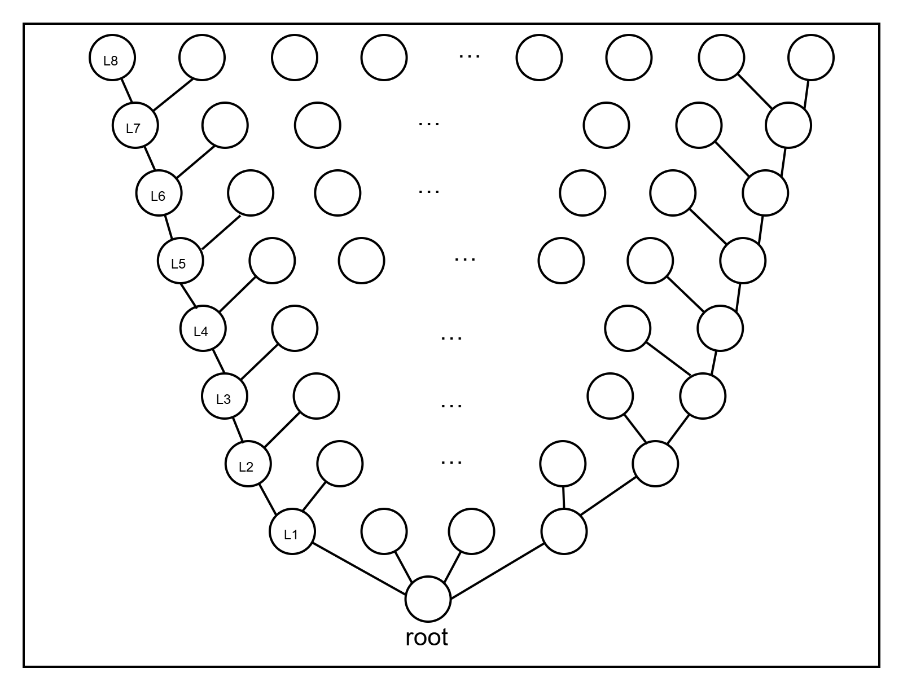</div>

**图 2-1 说明：** 图中底部 Root 到顶部 Leaf 表示调度树的拓扑挂接关系。TX_SCHED 工作在发送方向：发送请求从 L8 Queue/QSet Leaf 向其 L7 parent 汇聚，parent 在直接 child 之间完成本层仲裁；获胜请求再依次进入 L6、L5、L4、L3、L2 和 L1 的上层仲裁，最终到达对应 Host 管理的目标 Port。也就是说，实际仲裁方向是 **Leaf → parent → Host/Port**。

八层拓扑由 Driver 和 Firmware 共同管理，调度结构特性如下：

1. 第一层固定 Host，跟物理 Host 一一对应，4 个节点。不可编程层次。
2. 第二层固定 CoS 层，每个 Host 节点 16 个子节点，与 Port0~1 下的 TC0~15 一一对应。不可编程层次。
3. 支持第 3~8 层为软件灵活定义编程层次，节点父子关系灵活可配置，其中子节点只能是比父节点更高一层的节点。
4. 固定前 1~4 层由 Firmware 管理，5~8 层由驱动管理。
5. L5 节点的父节点由 Firmware 根据 `tc_id` 分配；L2～L4 节点作为父节点时，在驱动中被抽象为 TC 节点。
6. 每个节点最多 16 个子节点。不允许跳层；一个 child 只能挂在相邻上一层 parent 下。
7. 支持每个节点都有唯一的 TEID。
8. 支持软件从叶子节点到根节点的 branch 可配置。
9.  L8 不能作为 parent。

### 2.2 拓扑规则与各层物理节点总数

**表2-1 各层物理节点总数**

| 层级 | 物理节点总数 |
|---|---:|
| L1 | 4 |
| L2 | 64 |
| L3 | 64 |
| L4 | 128 |
| L5 | 2048 |
| L6 | 4068 |
| L7 | 4068 |
| L8 | 6144 |

L8 最多提供 6144 个硬件节点，因此整卡同时存在的 Queue、VDPA Queue 和 QSet 合计不能超过 6144。软件优化的重点是减少承载这些 Leaf 所需的 L5～L7 中间节点，而不是改变 Firmware 提供的节点总数。

### 2.3 Host、Port、TC

每个 Host 的 Port 数量有 1、2、4 三种选择，由硬件决定。4 个 Host 共对应 64 个 TC，因此单host存在以下三种情况：

<div align="center">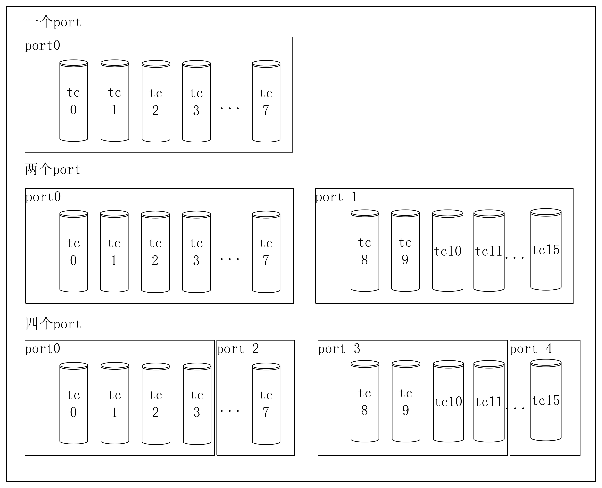</div>

图 2-2 说明：

1. 1 个 Host 对应 1 个 Port 时，一个 Port 对应 8 个 TC。
2. 1 个 Host 对应 2 个 Port 时，一个 Port 对应 8 个 TC.
3. 1 个 Host 对应 4 个 Port 时，一个 Port 对应 4 个 TC.

硬件支持每 Host 1、2、4 个 Port 三种形态；单 Port 最多启用 8 个 TC。

### 2.4 队列映射

**表2-2 队列映射**

| 队列类型 | 最大规模 | Leaf 映射 |
|---|---:|---|
| TX_LAN Queue | 4096 | QID 与 L8 TEID 建立映射 |
| VDPA Queue | 与 TX_LAN 共用 4096 规模 | VQID 与 L8 TEID 建立映射 |
| RDMA QSet | 2048 | QSet ID 与 L8 TEID 建立映射 |

业务在绑定 Queue/QSet 时，提供队列信息。驱动负责将对应的 QID 通过 AdminQ 下发到固件，并将 Firmware 返回的 TEID 写入业务树实例，形成 `Queue/QSet 队列信息 -> Node -> TEID` 的映射。业务需要操作某个 Queue/QSet 时，从对应业务树实例取得 TEID；业务得到 TEID 后，可以根据 TEID 对节点配置 QoS 策略，Driver 不再增加第二层节点编号或 TEID 转换。

### 2.5 速率与仲裁

#### 2.5.1 速率含义

<div align="center">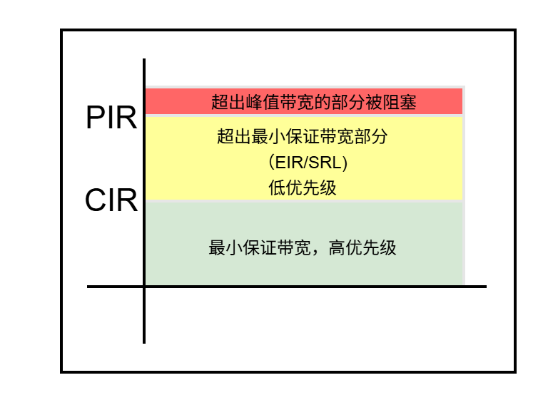</div>

图 2-3 说明：

**表2-3 速率含义**

| 类型 | 设计含义 | 主要约束 |
|---|---|---|
| CIR | 节点获得的最小保证带宽 | 优先于 EIR/SRL 参与调度 |
| EIR | CIR 满足后的剩余带宽份额 | 同一父节点、同一优先级内按权重归一；与 SRL 同时配置时按硬件确认含义处理，本文采用 SRL 生效 |
| PIR | 单节点最大速率 | — |
| SRL | 多个节点共享的总带宽池 | Firmware 最多提供 1024 个 SRL 配置项 |

本模块支持多种带宽分配机制，可以应用于调度树的任意节点。这些机制定义了子节点如何使用和共享父节点资源。这些限制是用带宽来表示的。

- 相对带宽分配，所有子节点共享他们父节点的带宽，如果一个子节点没有消耗完分配给它的带宽，未使用的带宽可以由其他兄弟节点分享。
- 峰值带宽(PIR)，即带宽限制(RL)，定义允许节点消耗的最大带宽，这是一个绝对的数值。当节点的流出流量大于带宽限制时，节点将被阻塞。单个子节点的带宽限制不能超过其父节点的带宽限制，但所有子节点的带宽限制总和可以超过父节点的带宽限制。
- 共享带宽限制(SRL)，允许为一组不归属同一父节点的节点定义一个带宽限制。一个节点在满足了其最小保证带宽后，可以从共享带宽中额外获取流量;如果没有消耗完配置给它的带宽，也可以贡献给该组中的其他节点使用。

#### 2.5.2 仲裁限速

1. 支持第一层 4 个 Host 之间，优先级相同，采用单速率 EIR 的 DWRR 仲裁。
2. 支持第二层同一个 Host 内 16 个 CoS 之间双速率（CIR-EIR）SP_DWRR 仲裁。
3. 支持 3-8 层最多 16 个兄弟节点之间进行双速率（CIR-EIR）SP_DWRR 仲裁。
4. 兄弟节点之间仲裁时 CIR 流量优先级高于 EIR 流量。
5. 支持第 2~8 层内同一个父节点的兄弟节点(至多 16 个节点)之间设置不同优先级，即不同优先级做 SP 仲裁，相同优先级做 RRDWRR 仲裁。
6. 节点 EIR 的 DWRR 权重值依据 EIR 的速率值可配置，比例关系相同权重默认值为 32768。
7. 支持节点配置 DWRR 权重最大比例为 1：200。
8. 支持任意一配置的节点 DWRR 的 EIR 仲裁实时信用值可读取。
9. 支持按照层级配置 RR 仲裁或 SP_DWRR 仲裁器，默认 RR 仲裁。

---

## 3. 需求范围

### 3.1 设计目标

TX_SCHED 设计需要同时满足以下目标：

1. 调度树的核心目的就是为了把队列绑定到调度树叶子节点上，供限速、仲裁使用。
2. 在满足业务拓扑约束的前提下，减少 L5～L7 中间节点消耗，避免某一中间层的剩余物理节点数先于 L8 降为零。
3. 不同业务能够独立定义拓扑和生命周期，新增或删除一个业务不要求重算全部业务树。
4. 所有业务通过一致的 Base 流程操作硬件，业务代码不直接拼装 Firmware 命令。
5. 软件记录只反映 Firmware 已确认的结果；错误、超时和部分成功均有确定处理。
6. Firmware 命令失败时返回明确错误，不创建只有拓扑外形、没有业务效果的节点。

本设计主要是驱动相关设计，固件相关设计请参考天蝎项目txsched模块概要设计 4.2 固件资源管理数据结构。

### 3.2 PF 侧需求

TXSCHED主要承载具体模块的功能调用需求，不直接承载产品需求，VF、QOS同理

**表3-1 PF 侧需求**

| 编号 | 业务 | 需求边界 |
|---|---|---|
| PF-01 | PF Eth | PF 自持队列映射调度树叶子节点。单个 PF 所属队列最多 256 个，与 RDMA 共用 1 个 VSI。 |
| PF-02 | FNAV | FNAV 特性使用队列下发流规则。每个 PF 使用 1 个队列，并独占一个 VSI。 |
| PF-03 | ethtool 自测命令 | 环回测试，每个 PF 使用 1 个发送队列和 1 个接收队列，进行自发自收环回测试。<br />其中发送队列需要映射调度树叶子节点，并独占 1 个 VSI。 |
| PF-04 | PF RDMA | RDMA QP 参与网卡调度需求，硬件 RDMA 引擎会将 QP 封装成 QSet，QSet 映射调度树叶子节点。<br />每个 PF 最多使用 9 个 QSet，PF RDMA 和 PF Eth 公用一个 VSI。 |
| PF-05 | PF DPDK | PF DPDK 自持队列映射调度树叶子节点，单个 PF 所属队列最多 256 个，独占 1 个 VSI。 |
| PF-06 | PF DPDK TM | DPDK QoS 特性，分配给 DPDK 独立 root 节点，root 以下由用户自定义调度子树拓扑，并能配置每个调度节点带宽，优先级和权重。<br />4 层用户可自定义拓扑的子调度树。<br />最多需要映射 256 个队列。 |
| PF-07 | MACVLAN | Linux 协议栈虚拟网络设备特性。macvlan 网络设备可使用 1 个硬件发送队列，该发送队列需映射调度树节点。<br />每个 PF 最多支持 64 个 macvlan 设备，每个 macvlan 设备独占 1 个 VSI。 |
| PF-08 | eSwitch representor | OVS 功能中每个 VF 需要在网桥上拥有各自的转发站点（VF 表示器），每个表示器为 1 个网络设备，每个网络设备自持 1 个发送队列。<br />一共 1008 个 VF，所以最多需要 1008 个发送队列。每个表示器使用 1 个 VSI。 |
| PF-09 | DCB 特性 | 流量分类：不同种流量映射到不同 CoS 中，硬件侧队列与 CoS 具有绑定关系，最多 8 个 CoS。<br />1. 根据用户分配的流量种类，使能 2 层调度树的 CoS 节点，并能配置每个 CoS 的限速和权重值<br />2. 每个 CoS 下的以太队列需要映射调度树叶子节点，每个 CoS 最多支持 256 个，单队列总和也为 256 个。<br />3. 根据 RDMA 请求将 QSet 映射到 CoS 子树下的叶子节点上。具体需求支持 9 个 QSet 映射。 |
| PF-10 | Bond 功能 | 两个 PF（两个 Port）合并，将一个 PF 的 RDMA QSet 迁移到另一 PF 子树下。<br />1. QSet 迁移操作<br />2. 迁移单个 PF 最多支持 17 个 QSet 节点。 |
| PF-11 | HTB 功能 | 协议栈多层令牌桶算法卸载需求：<br />1. 每个 PF 用户可自定义 3 层调度树拓扑和调度节点限速，权重值配置。<br />2. 最多 256 个叶子节点，深度最大为 3。<br />3. 叶子节点层级上移操作。 |
| PF-12 | mqprio 功能 | 二层协议栈流量划分 channel。最多 16 个 channel，每个 channel 自持队列映射调度树节点和配置限速。每个 channel 最多支持 16 个队列。 |
| PF-13 | devlink | 按照用户配置重新构建 Eth PF 调度子树拓扑，与 DPDK TM 需求相同。 |

### 3.3 VF 侧需求

**表3-2 VF 侧需求**

| 编号 | 业务 | 需求边界 |
|---|---|---|
| VF-01 | VF Eth | VF 自持队列映射调度树叶子节点。单个 VF 所属队列最多 64 个，每个 VF 使用 1 个 VSI 并与 RDMA 公用 |
| VF-02 | DPDK VF | VF DPDK 自持队列映射调度树叶子节点，单个 VF 所属队列最多 64 个并独占 1 个 VSI。 |
| VF-03 | VDPA | VDPA 特性自持 VirtQueue 映射调度树叶子节点，VirtQueue 最多 64 个并独占 1 个 VSI。 |
| VF-04 | DPDK VDPA | DPDK VDPA 特性自持 VirtQueue 映射调度树叶子节点，VirtQueue 最多 64 个并独占 1 个 VSI。 |
| VF-05 | VF RDMA | 功能与 PF RDMA 类似。未开启 Bond 时每个 VF 使用 1 个 QSet；开启 Bond 后每个 VF 最多使用 8 个 QSet。 |
| VF-06 | VF RDMA 与 DCB 交织 | 1. RDMA 可制定不同 QSet 映射到不同的 CoS 子树的叶子节点上。<br />2. VF 满规格（1024 个 Function）时，只能使用 2 个 CoS，节点资源限制。 |
| VF-07 | VF DPDK TM | DPDK QoS 特性，用户自定义调度子树拓扑，并能配置每个调度节点带宽，优先级和权重。<br />2 层用户可自定义拓扑的子调度树，最多可映射 64 个队列节点。 |

### 3.4 QoS 需求

**表3-3 QoS 需求**

| 编号 | 操作 | 目标节点与含义 |
|---|---|---|
| RL-01 | VF 限速 | 限制单个 VF 的最大最小带宽，内核，DPDK 和 RDMA 都需要限制。 |
| RL-02 | TM 功能 | DPDK 可任意配置 root 子树下节点的优先级、比例带宽和限速信息。 |
| RL-03 | CoS 限速和带宽 | 配置每个 CoS 节点的限速和带宽，DCB 场景。 |
| RL-04 | Eth PF 队列限速 | 配置单队列的最大限速，PIR 配置。 |
| RL-05 | VF 划组限速 | 多个 VF 组成一个 Group，对 Group 限速（SRL 共享带宽池） |

### 3.5 非功能需求

**表3-4 非功能需求**

| 维度 | 要求 |
|---|---|
| 可扩展性 | 新业务通过业务接口层和通用 Base 流程接入，不修改其他业务拓扑含义 |
| 可维护性 | 业务接口层、Base 各自只有一个明确责任中心 |
| 一致性 | 软件状态以 Firmware 已确认结果为准，不猜测未确认结果 |
| 故障隔离 | 一棵业务树失败不破坏无依赖的其他业务树 |
| 可定位性 | 能通过 Queue/QSet 队列信息取得 TEID，并使用 TEID 定位 Base 中对应的 Node |
| 可观测性 | 关键操作有输入摘要、Firmware 结果、Linux 错误和各层已确认节点数变化；拓扑打印以 Base 保存的 Node 为依据 |

---

## 4. 候选方案与选型

### 4.1 评价基准

两套方案都必须满足相同硬件约束和业务范围，按以下维度评价：

1. L5～L7 中间节点消耗是否与业务规模匹配。
2. 业务新增、删除和配置变化是否影响其他业务。
3. 软件能否明确记录每个节点归属的业务树实例，并保持软硬件一致。
4. 故障能否被限制在单个业务实例或单棵 tree 内。
5. 业务接口实现者能否在不接触 Firmware 细节的情况下完成业务接入。

### 4.2 方案一：固定层级定义与集中协调方案

方案一为 L5～L8 预先定义统一业务含义：L5 表示 PF/VF root，L6 表示 VSI，L7 表示 QG，L8 表示 Queue/QSet。所有业务接入同一套固定层级，并由集中管理逻辑协调节点和业务关系。

方案一的主要设计如下：

- 所有业务使用相同的四层含义，L5 层代表 Function，L6 代表 VSI，L7 代表 QG, L8 是代表队列 Queue 或 QSet。业务差异通过节点类型和全局映射表达。
- probe 阶段预建所有的中间节点（所有非叶子节点都是中间节点），open/start 阶段主要补充 Leaf 以及 Leaf 与队列的绑定。
- 由 core 驱动知道所有业务节点类型，并协调共享、冲突和删除顺序。
- 配置变化需要分析其对公共拓扑中其他业务节点的影响。

方案一层次含义说明：

**表4-1 方案一层次含义**

| 层级 | 层次命名 | 设计意义 |
|---|---:|---|
| L1 | Host | 每个节点，代表一个 Host 主机。 |
| L2 | CoS | 每个节点代表一个 TC，每个 Host 可对应多个 Port。 |
| L3 | VEB | 无实际物理意义，为了满足 1 个 TC 节点下可以挂载 1k 个 Function 节点。 |
| L4 | Function Group | 无实际物理意义，为了满足 1 个 TC 节点下可以挂载 1k 个 Function 节点。 | 
| L5 | Function | 根据特性规划，每个 node 代表一个 Function。 |
| L6 | VSI | 该层每个节点表示一个硬件物理 VSI。 |
| L7 | Queue Group | 无实际物理意义，为了保证一个 VSI 下最多挂载 256 个节点。 |
| L8 | Queue/QSet | 该层每个节点会关联一个硬件物理 LANQ 或 QSet。 |

**调度节点拓扑构建流程**：

1. 固件上电
2. 驱动 probe 阶段，由 core 驱动负责。
3. 驱动的 open/start 阶段，由辅助驱动负责。（业务的开启）

<div align="center">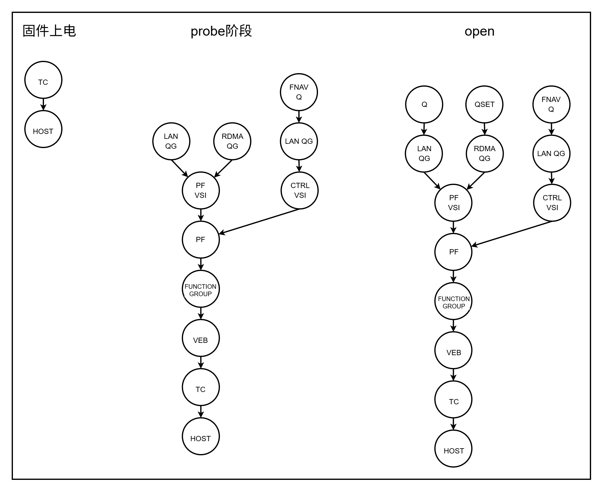</div>

**图 4-1 说明：** 固件初始化阶段负责将创建 Host/TC 节点，probe 阶段创建除队列节点外的所有节点，（FNAV 特性除外，此特性需要在 probe 将叶子节点创建）。open 阶段创建所有的叶子节点。

以 VF 为例，每个 VF 在 L5 拥有独立 VF root，再通过 VSI、QG 到达 Queue/QSet：

<div align="center">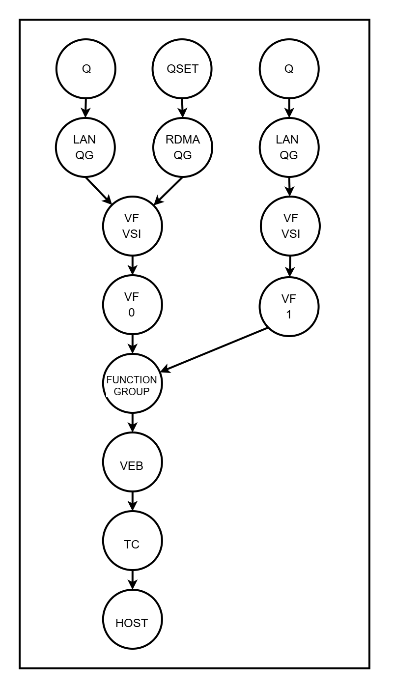</div>

**图 4-2 说明：** 每个 VF 独占一个高层 L5 节点，VF 下再区分 Eth、DPDK 和 RDMA 分支。该结构保持固定业务含义，但 1008 个 VF 会直接消耗 1008 个 L5 节点，尚未计入 representor、PF 和其他独立业务 root。

#### 4.2.1 各层节点数量表现

**表4-2 方案一各层节点数量表现**

| 场景 | 逻辑展开 | 主要结果 |
|---|---|---|
| 16 PF + 1008 VF + 1008 representor | PF、VF、representor 分别占用 L5 root | L5 使用 1025/2048（50.05%），L8 仍有空间但 L5 已经占用一半 |
| 16 PF 启用 8 TC | PF 在 8 个 TC 下形成 128 个逻辑副本 | L5 消耗随 TC 数线性增加 |
| 960 VF 分配到 2 个 TC | 形成 1920 个 VF 逻辑副本 | 与 128 个 PF 副本合计可达到 2048 个 L5 节点（100%） |

上表后两行属于同一个 DCB 压力场景：16 个物理 PF 分别展开到 8 个 TC，形成 128 个 PF 逻辑实例；960 个物理 VF 分别展开到 2 个 TC，形成 1920 个 VF 逻辑实例，合计占满 2048 个 L5。这里的 128 和 1920 是跨 TC 展开后的**逻辑节点实例数**，不是物理 PF/VF 数量；即使物理 VF 尚未达到 1008 满规格，L5 也已耗尽。

#### 4.2.2 适用条件与限制

方案一适合业务种类少、拓扑长期不变且 L5～L7 剩余物理节点数明显高于业务需求的系统。当前 TX_SCHED 同时存在大规模 VF、representor、多 TC、动态 TM 和多个独立生命周期，固定定义会让 L5 节点先于 L8 耗尽。同时在需要适配业务场景变多之后，会使公共管理拓扑变得复杂。

### 4.3 方案二：业务自治与 Base 统一管理方案

方案二不再为 L5～L7 固定唯一业务含义。而是采用业务接口层 + Base层组合，严格按照业务需求单独规划的方式进行设计。每个TXSCHED的业务根据需求设计自己的连续拓扑（业务接口层），Base 只验证这些节点是否满足硬件规则，并统一构建业务的拓扑并执行 Firmware 操作。

方案二的主要设计如下：

- 每个业务决定自身分组方式、拓扑深度和生命周期。
- Base 只负责对通用拓扑的创建，本质就是负责树的创建与删除，不考虑业务节点含义。
- Base 负责公共父节点的维护，父节点包括PF root, VF root，逻辑 TC root。
- 每个业务的业务树的父节点必须是这公共父节点，不允许存在互相依赖的情况。
- 负责对固定 Function 级别的调度节点的构建。
- 大规模 VF 使用 VF_Group，eSwitch 使用 L6/L7 分组；各动态业务自行确定创建、配置、删除和异常处理，Base 只执行通用硬件操作规则。

调度节点的创建流程同理，同样是三个阶段。

<div align="center">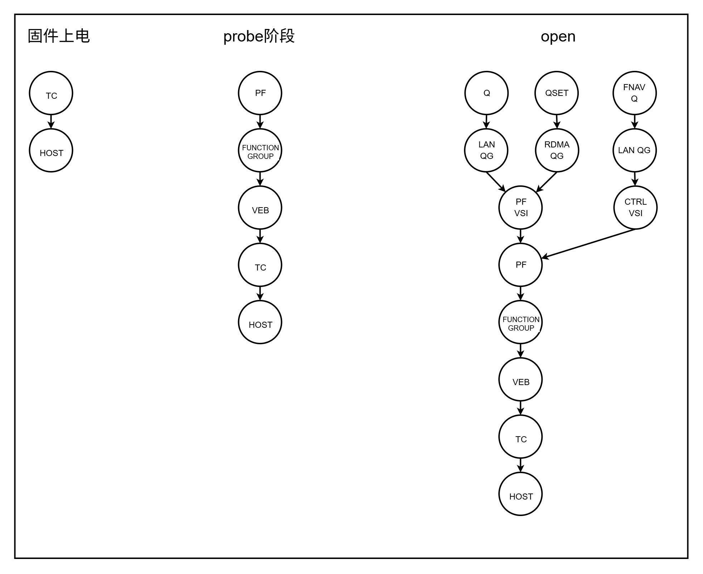</div>

**图 4-3 说明：** 方案二的 Firmware 上电阶段与方案一相同，由 Firmware 维护 L2～L4 公共父节点。Driver probe 仅创建公共 L5 PF 节点；业务在 open 阶段取得该 parent 后，按自身拓扑按需创建其余 L6～L8 节点。与方案一不同，probe 不预建固定定义的中间节点，open 阶段各层需要新增的节点数、分组方式和 Leaf 类型均由业务决定。

同样以 VF 为例，每个 VF 在 L6 有独立的调度节点，再通过 QG，到达 Queue/QSet：

<div align="center">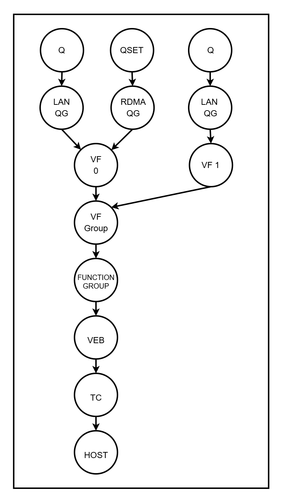</div>

**图 4-4 说明：** VF 先按最多 16 个为一组共享 L5 VF_Group，每个 VF 在 L6 拥有独立节点，再从 L7 分出 Eth、DPDK 和 RDMA 队列组。1008 个 VF 最多需要 63 个 L5 VF_Group，使 L5 节点数由“每个 VF 占一个”变为“VF 数量除以 16 后向上取整”。

#### 4.3.1 中间节点数量优化

优化如下：
1. **Function 级别**，VF 与 TC 增加中间层，使 VF 的节点的层次都在 L6 层，如图 4-4。
2. 中间层节点只用于满足硬件分组限制，不承载业务语义。若某层没有物理含义也没有限速需求，则不创建该层调度节点，按队列数量直接划分各层。以 Eth PF 为例：256 个队列需要 256 个 L8 Leaf 和 16 个 L7 QG；
3. 队列与 VSI 的归属关系在队列分配时已确定，由业务自身的队列管理维护（非 TXSCHED 模块），调度树默认不保存 VSI 信息。
4. 需要由用户下发，在程序运行期间进行动态创建的流程。给独立的 root 节点，父亲节点为 TC ，其调度节点的创建在 root 下进行，不会影响其他业务。

**表4-3 方案二中间节点优化**

| 业务 | 拓扑 | 中间节点效果 |
|---|---|---|
| VF | 16 个 VF 共享一个 L5 VF_Group | 1008 个 VF 最多使用 63 个 L5 Group |
| eSwitch | 1 个 L5 root、4 个 L6 Group、63 个 L7 QG、1008 个 L8 Leaf | 不为每个 representor 创建独立 L5/L6 |
| DPDK/HTB | 独立 L5 root，下层按固定或动态模型构建 | 动态节点变化不影响其他业务树 |

#### 4.3.2 代价

方案二增加了中间层 Base、业务树实例。实现者需要明确提供创建业务树的模板，和存储业务树实例。业务树模板和业务树实例的具体内容，详情见 5.5.4 和 5.5.5。

### 4.4 方案对比

**表4-4 方案对比**

| 维度 | 方案一：固定层级含义与集中协调 | 方案二：业务自治与 Base 统一管理 |
|---|---|---|
| 拓扑含义 | L5～L8 对所有业务含义固定 | L5～L7 由业务按需组织，L8 统一为 Leaf |
| L5 利用 | PF/VF 或业务实例容易独占 L5 | 公共 PF root、VF_Group 和业务分组降低 L5 消耗 |
| 中间层语义 | 层级固定即语义，不可按业务裁剪 | 中间层仅为挂接点，按实际业务需求才确定实际层次的物理意义 |
| 业务耦合 | core 驱动理解全部业务并协调变化 | 每个业务只管理自己的 tree 和逻辑配置 |
| 新业务接入 | 需要扩展全局节点类型和公共状态 | 复用 Base 通用流程，新增独立业务模型 |
| 故障影响 | 集中式公共拓扑使故障影响跨业务扩散 | 无依赖 tree 继续有效，故障限制在业务边界内 |
| Firmware 访问 | 多业务逻辑容易直接依赖命令细节 | Base 统一调用 Core 已有的 AdminQ，业务接口层不接触 Firmware 命令格式 |
| 软硬件一致性 | 全局状态复杂，局部失败整体创建失败 | Base 按 Firmware 逐项确认结果更新 |
| 实现复杂度 | 初期较低，随业务数量快速增长 | 初期需要 Base 和业务树实例，后续扩展成本稳定 |
| 适用场景 | 业务较少、拓扑固定且 L5～L7 剩余物理节点数充足 | 多业务、大规模 VF、多 TC 和动态拓扑 |

### 4.5 选型结论

本设计选择**方案二：业务自治与 Base 统一管理方案**，理由如下：

1. L5 只有 2048 个节点，而 VF、representor 和 DCB 展开均会直接放大 L5 消耗；分组和共享外部 parent 是满规格业务的必要条件。
2. PF、VF、DPDK、HTB 等业务的拓扑和生命周期差异明显，统一固定含义不能降低整体复杂度，只会把复杂度集中到全局协调逻辑。
3. Base 能够统一检查硬件规则、节点归属、并发控制和结果同步，使业务自行设计拓扑不等于业务直接操作硬件。
4. 方案二允许后续新增业务而不改变现有业务树；PF-13 devlink 可以在方案明确后独立接入。

后续章节只描述选定方案。方案一仅作为本章的完整候选设计存在，不再作为后续论述的反面参照。

---

## 5. 总体架构

### 5.1 软件分层

本文中的"业务"均指 TXSCHED 架构内针对各类需求（Eth、RDMA、DPDK 等）设计的业务接口层，而非业务本体；业务本体不感知调度树形态，由业务接口层完成从业务需求到调度树模型的转换。

<div align="center">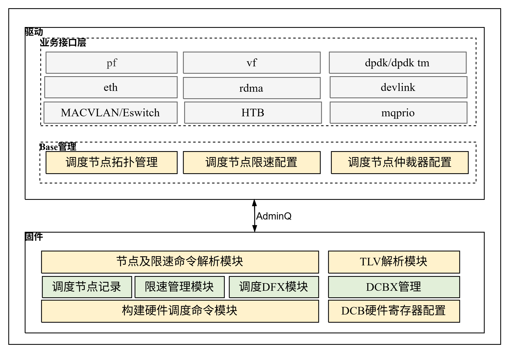</div>

**图 5-1 说明：** 图中 PF、VF、DPDK、RDMA、HTB、mqprio、MACVLAN、eSwitch 和 devlink 分别代表发起调度树操作的具体业务；每个业务管理自身配置和创建销毁时机；Base 统一检查和记录拓扑，并通过业务树实例维护 Queue/QSet 到 TEID 的映射；Base 的通用操作转换 AdminQ 命令通知 Firmware；Firmware 和硬件完成命令执行及实时调度。

从职责上，软件划分为业务接口层、Base 和 Firmware。业务接口层与 Base 是本设计的主要分界。

### 5.2 架构原则

选定架构按以下原则划分业务接口层、Base 层与 Firmware 之间的责任边界。

1. **各业务决定自身调度树的用途和形态**：业务根据自身需求，决定创建业务树的目的、所需层级、每层节点数量以及父节点。具体业务还负责决定何时创建、何时停止流量并销毁、何时绑定 Queue/QSet 并保存 TEID ，以及 PFR 后是否根据保存的逻辑配置重新创建。Base 不参与这些业务决策，只负责执行通用检查、操作节点并记录结果。
2. **Base 统一检查并管理各业务都必须遵守的硬件规则**：业务提交 Tree Template 后，Base 在发送 Firmware 请求前完成以下检查：parent 是否有效；L5～L8 层级是否连续；L8 是否为 Leaf；每个 parent 的直接 child 是否超过 16；操作是否超出该业务树实例的范围，是**保证后续各业务不耦合到一起的关键**，主要通过前期业务分类来保证，需要在编码前收集所有业务需求并进行类型划分保证不耦合（后续会通过所有业务树的集合说明）；以及各层新增节点数与当前已确认节点数之和是否超过该硬件层物理节点总数。
3. **Base 通过 AdminQ 与 Firmware 交互**：Base 向 AdminQ 接口提交已经校验过的通用操作信息，例如操作类型、parent TEID、目标层级、本次新增节点数、节点属性和 Queue/QSet 队列信息。AdminQ 接口负责将这些信息转换为具体 Firmware 命令，并完成命令发送、原始响应校验、逐项结果解析、返回 TEID 提取和错误转换。Base 层设计不直接使用 Firmware 命令码、命令结构或原始响应格式。
4. **软件状态只反映 Firmware 已明确确认的结果**：请求已发送并不代表节点已创建或删除。Base 只根据 Firmware 返回的逐项结果更新软件记录：成功项立即更新，失败项保持调用前状态。出现部分成功时，记录部分成功节点，不能把整个请求当作成功，也不能猜测未确认项的硬件状态。
5. **共享父节点**：每个业务树必须确认一个父节点进行挂载，父节点的类型必须是 PF 节点、VF 节点、TC 节点，即业务树不能出现互相依赖的情况。销毁子树不得修改或删除父节点。

### 5.3 分层职责

**表5-1 分层职责**

| 层 | 负责 | 不负责 |
|---|---|---|
| Eth、RDMA、DPDK 等具体业务 | 各自的业务配置、唯一父节点、创建销毁时机、TEID 使用和错误处理 | 维护业务树实例、并发控制、直接 Firmware 请求 |
| Base | L5～L8 通用拓扑、业务树实例、调度节点的增删改、各层已创建节点数、公共 PF root、VF root、并发控制、结果记录和日志 | 调度树的节点分配（树的形态）、增删改的时机、错误处理 |
| Firmware | L1-L4 层调度节点管理，TEID 管理，以及对硬件节点，限速和仲裁信息配置提供接口 | Driver 业务生命周期和逻辑配置保存 |

### 5.4 层间协作

<div align="center">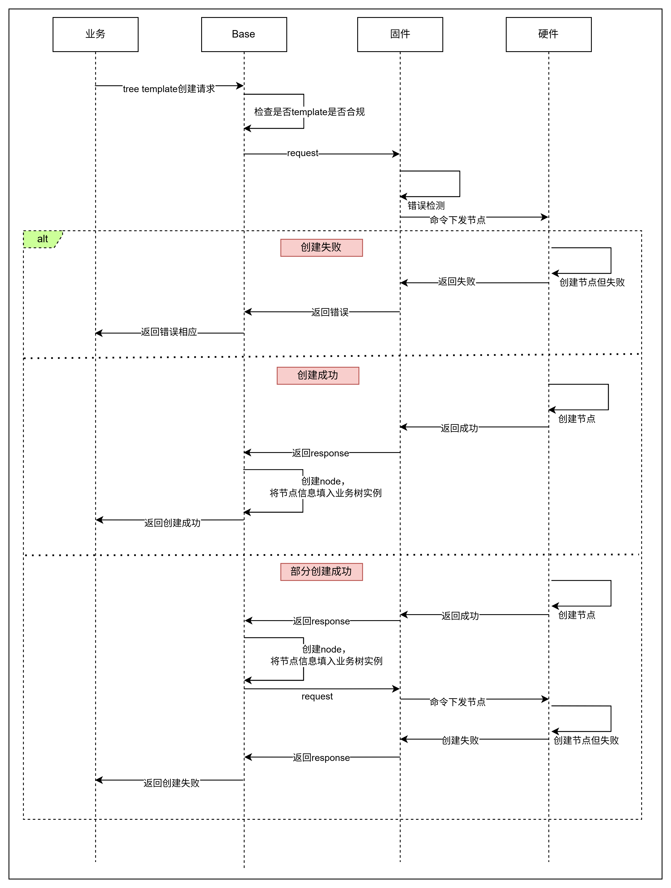</div>

**图 5-2 说明：** 业务分别提交 Tree Template；Base 完成合法性检查后，将 Template 解析成一组命令，通过 AdminQ 访问 Firmware，并只记录 Firmware 明确确认成功的项。各层的逐步责任见下方列表。

一次修改操作的责任传递顺序固定为：

1. 发起操作的具体业务准备 Queue/QSet 队列信息、external parent、拓扑描述和 QoS 配置；已有节点操作直接提交 TEID。
2. Base 在同一 Context 并发控制范围内定位业务树实例并校验层级和 child，确认本次各层新增节点数与当前 Context 对应层已确认节点数之和不超过该硬件层物理节点总数。
3. AdminQ 将 Base 的通用请求转换为 Firmware 命令，并将原始响应转换为统一逐项结果。
4. Base 按 Firmware 返回结果更新软件记录。

### 5.5 核心对象定义（约定）

本节定义软件架构中重要对象必须承载的核心含义。后续详细设计可采用不同的实现方式，但不能改变对象之间的责任与生命周期边界。

#### 5.5.1 对象关系

TXSCHED 四类核心对象区分“调用者想创建什么”和“Firmware 已经创建了什么”。

<div align="center">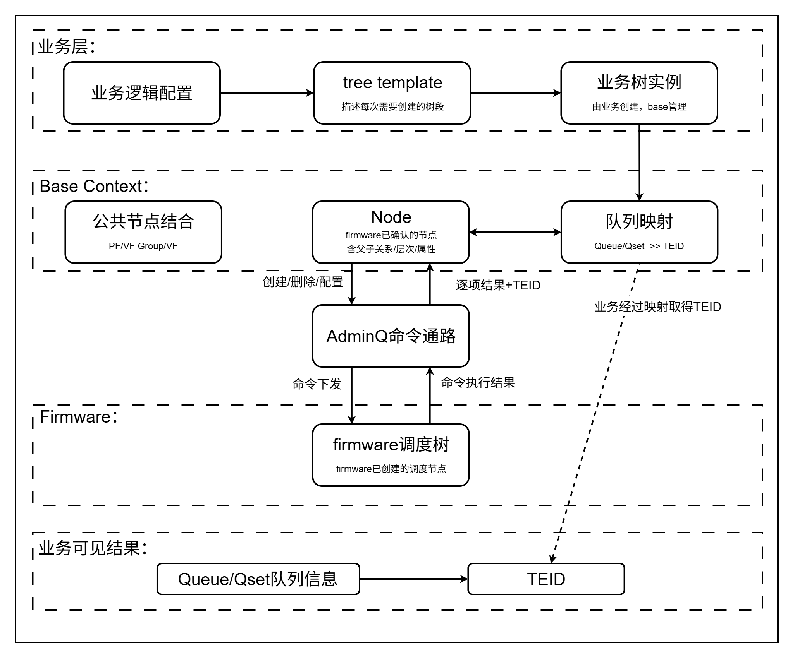</div>

**图 5-3 说明：** 具体业务创建业务树实例，并利用 Tree Template 批量创建调度树节点或者单节点创造来构建业务树。业务树实例中保存了对应的节点 TEID 信息，用来辅助业务建立 Queue/QSet 队列信息到 TEID 的映射。Base Context 负责保存所有调度节点，以及节点的父子关系。Function 级别的节点创建和已确认节点的索引。

#### 5.5.2 Node

Node 是 Base 对一个 Firmware 已确认软件调度节点的记录，存储在驱动内存中；业务使用 TEID 定位节点，不直接访问 Node 内部数据，至少包含以下信息：

包含层级、TEID、parent/child、队列信息和已确认属性

```c

enum sxe3_txsch_node_role {
    SXE3_TXSCH_NODE_ROLE_ROOT,      /* PF root */
    SXE3_TXSCH_NODE_ROLE_VF_GROUP_ROOT, /* VF Group */
    SXE3_TXSCH_NODE_ROLE_VF_ROOT,   /* VF root */
    SXE3_TXSCH_NODE_ROLE_INNER,     /* 业务树中间节点 */
    SXE3_TXSCH_NODE_ROLE_LEAF,      /* L8 叶子节点 */
};

/**
 * Base 层调度树节点结构
 * 
 * 设计要点：
 * 1. 纯拓扑结构，不包含任何业务相关字段
 * 2. 生命周期由业务接口层显式管理（单节点接口）或 Base 层管理（批量接口）
 */
struct sxe3_txsch_node {
    /* === 公共字段（所有 Node 都有）=== */
    u32 teid;              /* 固件返回的 TEID */
    u32 parent_teid;       /* 父节点 TEID */
    u8  layer;             /* 节点所在层级（5~8）*/
    enum sxe3_txsch_node_role  role;
    struct sxe3_txsch_tree_instance *owner; /* 归属：公共节点为 NULL，业务节点指向所属业务树实例 */
    struct sxe3_txsch_rate_config rate;  /* QoS 速率配置 */

    /* === 按角色区分的字段 === */
    union {
        struct {
            u32 teid[16];  /* 子节点 TEID 数组 */
            u8  num;       /* 实际子节点数 */
        } child;

        struct {
            u8  is_bind;
            u8  queue_type;        /* TX_LAN / RDMA QSet / VDPA */
            u32 queue_id;          /* QID / QSet ID / VQID */
            /* 必要时可再加业务标识 */
        } leaf;            /* layer == 8 */
    };
};

```

**表5-2 Node 信息类别**

| 信息类别 | 必须表达的内容 |
|---|---|
| 硬件定位 | 当前 TEID 和节点所在的层级|
| 拓扑关系 | 已确认的 parent TEID 和 child TEID 数组 |
| 通用角色 | PF root、VF root、VF Group root、inner 或 Leaf |
| Leaf 映射 | Firmware 已确认的 Queue/QSet 队列信息 |
| QoS 确认值 | Firmware 已成功接受的优先级、权重和速率属性 |

只有 Firmware 的操作命令成功，才会触发 Node 节点的创建、修改、删除。存储在 Base Context 内部，不记录具体的层级含义。

#### 5.5.3 Base Context

Base Context 表示 core_dev 的 TX_SCHED 管理域。每个 core_dev 拥有独立 Context。因此 Base 的并发控制域和各层已确认节点数统计均以 Context 为单位。一个 Context 至少需要承载以下含义：

```c

struct sxe3_txsch_base_context {
    struct mutex lock;                 /* 一把大锁，所有操作都需要持锁 */
    
    /* === 硬件能力 === */
    struct sxe3_fwc_txsched_cap_resp cap;
    
    /* === 按层分配的节点数组 === */
    struct sxe3_txsch_node *nodes[SXE3_TXSCHED_HW_LAYER_8];  /* 索引：layer (0-8)，实际使用 5-8 */
    /* === 每层容量配置 === */
    u16 layer_size[SXE3_TXSCHED_HW_LAYER_8];                 /* 每层最大节点数 */
    u16 layer_used[SXE3_TXSCHED_HW_LAYER_8];                 /* 每层已使用节点数 */

    struct sxe3_txsch_node *pf_root;    /* L5，所有 PF 业务共享 */
    struct sxe3_txsch_node **vf_group;  /* L5 VF Group 数组 */
    struct sxe3_txsch_node **vf_root;   /* L6 VF root 数组，按 vf_id 索引 */
    
    /* === SRL Profile 管理 === */
    struct sxe3_txsch_srl_context srl_ctx;  /* SRL Profile 管理上下文 */
    
    /* === 设备上下文 === */
    struct sxe3_core_dev *core_dev;    /* 用于调用固件命令 */
    /* === 调试支持 === */
    struct dentry *debugfs_dir;
};

```

**表5-3 Base Context 信息类别**

| 信息类别 | 必须表达的内容 | 目的 |
|---|---|---|
| 并发控制 | 同一 Context 的修改操作串行执行，并记录在途操作边界 | 使校验、Firmware 命令和状态提交保持一致 |
| 各层节点记录 | Firmware 提供的各硬件层物理节点总数、当前设备各层已确认节点数 | 创建前比较与该硬件层物理节点总数，并记录成功 `ADD`/`DEL` 后的变化 |
| 拓扑构建 | PF 、VF 、全部已确认 Node 及其索引 | 父子关系、定位和状态打印 |
| 异常节点 | 部分 `ADD` 成功的业务树或子树，返回已经创建的业务树实例（创建过程自顶向下，失败也是树形结构或退化成链表） | 方便释放部分创建成功的调度节点，防止硬件节点泄漏 |

Context 不保存其他 PF 的实时节点占用，不保存业务配置、业务对象指针或 PFR 后的业务重建策略。PFR、Reset 或 Remove 后，Base 清除旧业务树实例、Node 和 Queue/QSet 到 TEID 的映射；后续新建节点继续直接使用 Firmware 新返回的 TEID。

#### 5.5.4 Tree Template

Tree Template 是业务提交给 Base 的树段描述。它回答“这次希望在业务树（业务树实例）下创建怎样一段连续拓扑”。通过接口调用的方式，Base 会根据 Tree Template 的具体内容以批量创建节点的方式，创建出一段连续的子调度树。一个 Template 至少需要表达：

1. 明确 Tree Template 只有最多 4 个层级，对应 Driver 管理的 L5~L8。
2. 每一层的节点配置的数量、优先级、权重和速率参数。配置同层一致，数量不能为 0。优先级、权重和速率参数可以不配置，使用默认配置。
3. 明确叶子层级，以及叶子层级与 Queue/QSet/VDPA 队列信息的映射关系。没有叶子层级可以不添加。
4. 两阶段的叶子节点创建，不应该由 Tree Template 来决定，而是业务通过专用接口自己决定。原则上 Tree Template 只负责批量创建节点，叶子节点的创建必须是默认绑定的。

注意：Tree Template 中**不指定父节点**，只指定每层节点的数量和配置。父节点由业务树实例负责指定。

**Tree Template 结构**
```c

/* Tree Template：描述一段连续拓扑 */
struct sxe3_txsch_tree_template {
    u8 start_layer;      /* 起始层：L5~L8 */
    u8 end_layer;        /* 结束层：L5~L8，必须 >= start_layer 且连续 */
    u8 leaf_layer;       /* 叶子所在层：0 表示本 template 不创建叶子 */

    /* 每层配置，索引 0 对应 start_layer */
    struct sxe3_txsch_template_layer layers[SXE3_TXSCHED_MAX_TEMPLATE_LAYERS];

    /* 直接 Leaf 路径使用：叶子节点队列绑定信息 */
    u16 leaf_queue_count;
    void *leaf_queues;
};

```

以 Eth PF 为例，在该设计方案中，Eth PF 仅需占用三层节点：L6、L7 和 L8。

Eth PF 只关注需要绑定的队列数量。只有 Queue 节点具有实际业务含义，并且需要绑定到叶子节点，因此队列与叶子节点一一对应：需要绑定多少个队列，就创建多少个叶子节点。

L6 和 L7 节点不承载实际业务含义，仅用于维护 L8 叶子节点的父子层级关系。

假设需要绑定 256 个队列，则节点模板可以设计为：

```
L6 Inner：1 个
└── L7 Inner：16 个，所有节点的 Parent 均指向上述 L6 节点
    └── L8 Direct Queue Leaf：每个 L7 节点最多挂载 16 个
        ├── 队列信息：QID
        └── 创建属性：该队列叶子节点所需配置的 QoS 参数
```

```c

struct sxe3_txsch_tree_template eth_template = {
    .start_layer = 6,
    .end_layer   = 8,
    .leaf_layer  = 8,

    .layers = {
        [0] = { .node_count = 1 },   /* L6: 1 个 eth_root */
        [1] = { .node_count = 16 },   /* L7: 16 个 QG */
        [2] = {                      /* L8: 256 个 Leaf */
            .node_count = 256,
            .has_qos    = false,
        },
    },

    .leaf_queue_count = 256,
    .leaf_queues      = eth_qid_array,  /* 256 个 QID */
};

```

因此，1 个 L6 节点下包含 16 个 L7 节点，每个 L7 节点挂载最多 16 个 L8 队列叶子节点，总计支持 256 个队列。

#### 5.5.5 业务树实例

业务树实例是 Base 为每个业务创建的调度树管理对象，保存该业务待构建的 L5～L8 调度节点集合。业务负责创建该实例，由 Base 层统一管理。

```c

struct sxe3_txsch_tree_instance {
    u32 parent_teid;         /* PF root / VF root / TC root */
    u8  layer_start;         /* 起始层 */
    u8  layer_end;           /* 结束层 */

    /* 该实例拥有的所有 Node 链表 */
    struct list_head node_list;

    /* 每层节点数统计 */
    struct {
        u16 count;
    } layer_info[SXE3_TXSCHED_MAX_TEMPLATE_LAYERS];  /* 索引 0 = layer_start */
    
    /* 队列到 TEID 的映射（业务接口层需要）*/
    struct sxe3_txsch_queue_map {
        u8  queue_type;      /* TX_LAN / RDMA_QSET / VDPA */
        u32 queue_id;
        u32 teid;
    } *queue_maps;
    u32 queue_map_count;

    struct sxe3_txsch_base_context *ctx;
};

```

业务树实例至少包含：

1. Base Context：用于向 Base 申请创建/删除调度节点，并维护父子关系。
2. 唯一的父调度节点：父节点只能是 PF root、VF root 或 TC root；业务树实例的所有节点必须挂接在同一父节点下，防止跨 Function 分布。
3. 最多 4 层连续硬件层级：记录每一层已确认调度节点的 TEID。

业务先指定父节点并创建空实例，随后通过 Tree Template 批量创建节点，或通过单个调度节点接口逐节点创建。业务树实例的生命周期由业务决定，所有操作都以该实例为对象，但业务不直接修改其内容，必须通过 Base 层接口完成。

#### 5.5.6 父节点的类型

业务树实例没有唯一的根节点，只有唯一的父节点。父节点可以是 PF、VF 或 TC。每个业务必须在创建业务树实例时指定父节点。

1. **PF root**：PF root 是当前 PF 的公共调度节点，所有业务都可以使用该 PF root 作为父节点。Base 在 probe 阶段创建 PF root。
2. **VF root**：由 PF 创建的 VF root 是当前 PF 业务在收到 mailbox 消息后按需创建的，所有业务都可以使用该 VF root 作为父节点。Base 在收到 mailbox 消息后创建 VF root，销毁时机由用户决定。
3. **TC root**：TC root 是由固件维护的，在驱动看是一个抽象的调度节点，这个节点在 L4 层。真正的 TC 层是 L2 层，由固件上电时就确认了。而驱动只需要知道 TC 的 `tc_id` 即可申请节点。

---

## 6. Base 层设计

### 6.1 Base 职责

1. 保存所有驱动侧的软件节点。
2. 管理当前 Context 内 Driver 可见的 L5～L8 节点及父子关系。
3. 在内部管理 Node，维护 Queue/QSet 队列信息到 TEID 的映射，并向业务返回可直接使用的 TEID。
4. 合法性校验，校验 parent、层级、child 数、Leaf 位置、队列信息和当前 Context 各层已确认节点数。
5. 串行执行同一 Context 的校验、Firmware 命令和软件更新。
6. 根据 Firmware 已确认结果维护节点、队列信息、各层已确认节点数和 TEID 记录。
7. 返回 AdminQ 转换后的明确错误，并保留 Node、TEID、队列信息供清理与定位使用。
8. 为业务接口层提供调度树拓扑和调度节点属性(限速，仲裁)信息更新接口。

### 6.2 调度树与节点归属

业务树实例是正常业务节点的归属边界：

1. 一个正常业务 Node 只能归入一个业务树实例，不能同时归入两个业务的实例。
2. 业务树实例记录其全部成员 Node 的 TEID ；Eth、RDMA、DPDK 等业务不能修改或删除其他业务实例中的 Node。
3. 业务树的父节点不归入当前业务树实例管理。销毁调度树不删除业务树父节点。
4. 在父节点还有子节点的情况下，不能直接删除父节点。必须先删除所有子节点，才能删除父节点。
5. Eth、RDMA、mqprio 等业务可以共享 TC 或 PF root，但是一个业务树实例只能代表一个业务。
6. 跨业务挂接只能通过互相的调度树节点实现，如 RDMA `move`，需要先在被移动的调度树节点上执行 `DEL`，然后在目标调度树节点上执行 `ADD`。
7. 删除调度树节点的软件记录不等于删除 Firmware 节点，只有通过 AdminQ 下发 `DEL` 命令，且 Firmware 回复成功，删除才算彻底。

### 6.3 公共 PF Root 和 公共 VF Root

为了区分 PF 和 VF 的硬件资源，需要由 Base 层维护公共节点的创建和销毁。所有业务都可以使用该 PF root 和 VF root 作为父节点。

根据目前的需求，单个 PF root 节点足以支持所有 PF 业务的业务树实例。所以不需要考虑多个 PF root 节点的情况。

**PF Root**
1. PF root 的生命周期是由驱动的 probe 阶段创建，驱动的 remove 阶段销毁。
2. PF root 的父节点是 L4 层的 TC root。

**VF Root**
1. VF root 的生命周期是由用户决定的。在 PF 收到 mailbox 消息后，创建 VF root。VF root 的销毁由用户决定。
2. VF root 按需创建：PF 收到某 VF 的 mailbox 请求后，Base 为该 VF 在所属 VF Group 下创建 1 个 L6 VF root；当现有 VF Group 已满 16 个 VF root 时，先创建新的 L5 VF Group 再挂接。VF Group 的父节点是 L4 层的 TC root。
3. 由于 VF root 节点已经在 L6 层，所以 VF 可分配的资源最多只有两层。

### 6.4 创建

#### 6.4.1 创建输入

批量创建时，业务必须在调用 Base 前确定：

- 该业务实例唯一的父亲节点。
- 连续的硬件层级和父子关系。
- 每层需要的节点数及调用者期望的稳定顺序。
- 业务树所使用的 Leaf 路径；在 Template 中提供每个 Leaf 和 Queue/QSet 的队列信息的对应关系，两阶段 Leaf 在后续 `bind/enable` 时提供队列信息。
- 需要在创建时生效的节点属性。

Base 层不对输入进行业务排序、负载均衡或含义合并。Base 只验证结果不违反硬件规则。

#### 6.4.2 创建处理

**单调度节点创建**
1. 中间节点和叶子节点的创建区分不同的接口。
2. 中间节点的创建需要验证父节点、层级、child 数和当前各层已确认节点数。
3. 叶子节点的创建需要验证父节点、层级、Leaf、队列信息和当前各层已确认节点数。
4. 只有 Firmware 返回成功，才会创建调度节点并填写对应的信息，并把 TEID 返回到业务树实例。

**Tree Template 的批量创建方式**
1. 验证 Tree Template 的合法性，包含验证层级、child 数、Leaf、队列信息和当前各层已确认节点数。
2. 自顶向下的顺序向 Firmware 申请调度节点，按 Tree Template 的层级和数量，批量创建调度节点。每次批量创建的节点数不超过硬件 child 上限。
3. 如果 Firmware 返回全部失败，则不创建任何节点，直接返回错误。
4. 如果 Firmware 返回部分成功，则只记录成功的节点，并返回错误。
5. 如果 Firmware 返回全部成功，则创建调度节点并填写对应的信息，并把 TEID 返回到业务树实例。
6. 直到所有层级的节点都创建成功，才算整个 Tree Template 创建成功。

### 6.5 Leaf 管理

Leaf 分为两种处理路径：

**表6-1 Leaf 管理路径**

| 路径 | 创建 | 删除 | 适用业务 |
|---|---|---|---|
| 直接 Leaf | `ADD` Leaf 时同时提交 Queue/QSet 队列信息 | 使用相同队列信息发送专用 `DEL` | Eth、VF、FNAV、普通 DPDK 等固定树 |
| 两阶段 Leaf | 先 `ADD` 通用 Leaf，取得 TEID 后再 `bind/enable` Queue/QSet | 直接使用对应的 `QUEUE/QSET DEL`，不先发送解绑或停用命令 | DPDK TM 等预建动态拓扑 |

### 6.6 删除

删除必须遵守依赖逆序：先 Leaf、再 inner、最后 root。Base 不提供“忽略节点归属并递归删除任意 parent”的普通业务功能。

1. 删除提供删除该节点下的所有节点（包含自身）和单调度节点的删除。
2. 批量删除时，按照 DFS 遍历删除，并按逐项确认结果立即更新软件记录。
3. 批量删除时，Firmware 返回部分成功，Base 只删除成功项，保留失败 Node 及其业务树实例，返回错误信息。
4. 单独节点删除时，Base 先检查该节点是否有 child，仍有 child 的 Node 不能删除。
5. 删除节点时，需要同步更新父节点与子节点的关系。

删除失败后不继续删除失败节点的 parent，也不恢复已经成功删除的节点。业务可以再次清理剩余节点，或进入上层决定的 PFR/reset 流程。

### 6.7 属性更新

节点限速、优先级和权重按单节点更新设计：

1. 由于硬件的设计，除第一层外，所有节点均有 CIR 和 EIR/SRL 带宽，且支持节点的优先级(基于兄弟节点之间)固件可配置。设置能力接口负责根据 TEID 对应的节点进行配置。
2. 在对调度节点设置时，需要判断节点归属问题，属于该业务树的节点才可以进行设置。
3. Qos的配置应该根据业务实际需求来。即没有物理含义的节点，不可以配置。
4. TC、Host 节点由固件创建和维护，驱动只能配置、不能创建或删除，与业务节点"创建/配置/删除"的完整操作集合不同，因此为这两类节点提供独立的能力接口。

### 6.8 结果同步与错误处理

1. Base 只根据 Firmware 已确认的结果更新软件记录；成功项立即更新，失败项保持调用前状态。
2. 出现部分成功时，不能把整个请求当作成功。Base 记录部分成功内容，并返回错误信息。
3. Base 不做失败重试，也不猜测未确认项的硬件状态。失败后业务可按 Base 已确认的记录回滚本次已创建的节点，或直接进入上层决定的 PFR/reset 流程。

### 6.9 并发

并发模型固定为每一个 Base Context 一把互斥锁（mutex）：

1. 同一 Context 内的业务树实例校验、本次各层新增节点数与当前 Context 各层已确认节点数检查、Firmware 命令和软件更新在同一次持锁范围内完成。
2. 不设置 TX_SCHED 跨 Context 全局锁；不同 Context 之间的资源冲突由 Firmware 仲裁。
3. Base 修改操作需要等待互斥锁和 Firmware 响应。
4. 业务接口层不维护第二把 TX_SCHED 锁。
5. Base 持锁期间不调用业务回调函数，避免反向依赖和锁顺序不确定。

该模型优先保证状态确定性。若后续性能数据证明单 PF 串行成为瓶颈，应基于测量另行设计，不能提前引入多状态异步处理。

### 6.10 PFR、Reset

在收到 PFR 或 Reset 请求时，Firmware 会清空当前所有的配置，驱动同理，需要清空当前所有的配置。PFR、Reset 和正常删除的逻辑不同，PFR 和 Reset 不需要再下发命令给 Firmware。PFR 的配置重建由业务侧重新下发配置。

### 6.11 可观测性

Base 的 Node 管理记录是 TX_SCHED 状态打印的唯一基础。状态查询由 Base 在 Context mutex 保护下生成一致性快照，或在锁内复制必要事实后再格式化输出。

包含的完整的状态信息打印至少包含：

1. 各个层次的节点信息，包含 TEID、父子节点的 TEID 信息。
2. 根据 PF 和 VF 为树的根节点，打印每个业务树实例的节点信息。
3. 根据 TEID 打印每个节点的属性信息，包括优先级、权重、速率属性和叶子节点绑定信息。

每次 Base 公共操作至少记录：

- 操作名称、和开始/结束时间。
- 父亲节点、目标层级、业务树实例和 Node；存在 TEID 时记录当前 TEID。
- 请求项数、成功项数和批量逐项结果摘要。
- Firmware 原始错误、和最终返回值。
- 操作前后的当前 Context 各层已确认节点数。
- 停止状态、操作目标属于其他业务、业务树实例已经过期等本地拒绝原因。
- 涉及 Node 变化时，能够关联状态打印中的 Context、业务树实例和 Node/TEID。

## 7. 业务拓扑与流程设计

### 7.1 业务设计方法

业务均按以下方法完成自身设计：

1. 确定业务的拓扑类型。分为固定拓扑，动态拓扑两种。
2. 确定业务资源类型（选择父节点），包括 PF、VF、TC。
3. 根据业务所需的具体物理含义设计层级语义（每一层代表什么，如 L8 叶子节点代表队列）
4. 根据队列个数与层级语义需求，按照硬件约束（16 child）设计业务树的分组方式。

业务拓扑分为两类：

**表7-1 业务拓扑分类**

| 模型 | 特征 | 典型业务 |
|---|---|---|
| 固定拓扑树 | 树的层级结构确定，运行期间不会改变，会随业务规模的变化而变化 | Eth、DPDK、RDMA 等 |
| 动态拓扑树 | 树的结构不能确定，由用户配置确定树的结构 | HTB，DPDK TM |

### 7.2 需求与设计模型映射

**表7-2 需求与设计模型映射**

| 需求 | 主设计模型 | 本章位置 |
|---|---|---|
| PF-01 | 公共 PF parent 下的 Eth 固定树 | 7.5.4 |
| PF-02、PF-03 | 独立 FNAV / ethtool 固定树 | 7.5.5 |
| PF-04 | 公共 PF parent 下的 PF RDMA QSet 树 | 7.5.7 |
| PF-05 | 独立 TC root 的普通 DPDK 固定树 | 7.5.9 |
| PF-06 | 必须分配 DPDK root，root 与配置子树分离的 DPDK TM 动态树 | 7.6.1 |
| PF-07 | 独立 TC root 的 MACVLAN 固定树 | 7.5.8 |
| PF-08 | 独立 TC root 的 eSwitch 分组树 | 7.5.8 |
| PF-09 | 多 TC 销毁重建 | 7.7.1 |
| PF-10 | RDMA 业务编排的 QSet `move` | 7.7.3 |
| PF-11 | HTB 动态 class 树 | 7.6.2 |
| PF-12 | 公共 PF parent 下的 mqprio Channel 树 | 7.5.6 |
| PF-13 | devlink 需求占位 | 7.6.3 |
| VF-01、VF-02 | VF_Group 下的 Eth VF / DPDK VF 配置树 | 7.5.10 |
| VF-03、VF-04 | VDPA 需求占位 | 7.5.11 |
| VF-05、VF-06 | VF RDMA QSet 树，以及多 TC 下的 QSet add/del/`move` | 7.5.10、7.7.2 |
| VF-07 | 授权 VF root 下的 DPDK TM 动态树 | 7.6.1 |
| RL-01～RL-05 | 节点属性和 SRL 配置 | 7.8 |

PF-13 和 VF-03、VF-04 只有需求映射，不代表本版已给出可实现设计。

### 7.3 所有业务树整体拓扑

<div align="center">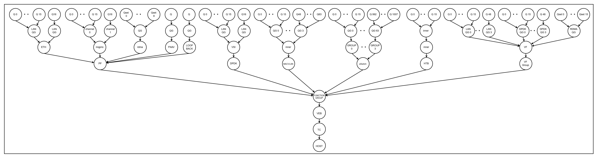</div>

**图 7-1 说明：** 本图以单个 PF 满配置为例，给出所有业务树在同一硬件调度拓扑中的挂接关系总览，作为 7.5～7.6 各业务详细设计的索引。

1. 底部 Host、TC、VEB、FUNCTION GROUP 为 Firmware 管理的 L1～L4 层，驱动不直接操作这些节点；L2～L4 在驱动中统一抽象为 TC root，作为业务树的父节点之一。
2. L5 层共 6 类 root：公共 PF root、DPDK root、MACVLAN root、eSwitch root、HTB root 和 VF Group。公共 PF root 由 Base 在 probe 阶段创建，其余 root 由对应业务按需创建。
3. 公共 PF root 下共享挂接 5 个业务子树：Eth（LAN QG + Queue，最多 256 个队列）、mqprio（channel + Queue，最多 16 个通道）、PF RDMA（QG + QSet，最多 9 个）、FNAV（单队列）和 LOOPBACK（ethtool 环回，单队列）。
4. DPDK、MACVLAN、eSwitch、HTB 四棵独立业务树以 TC root 为父节点：DPDK 经 VSI、LAN QG 到达 Queue；MACVLAN 经 inner、4 个 QG 承载 64 个 Queue；eSwitch 经 4 个 GROUP、63 个 QG 承载 1008 个 representor Queue；HTB 的 inner 层级与深度由用户配置决定。
5. VF Group 是 16 个 VF 共享的 L5 节点，其下每个 VF 独占 1 个 L6 VF root；VF root 下按业务分为 LAN QG（Eth VF，最多 64 队列）、DPDK QG（DPDK VF，最多 64 队列）和 RDMA QG（VF RDMA QSet）三个分支。
6. 图中 QG、GROUP、inner 等中间节点仅用于满足“每个 parent 最多 16 个直接 child”的分组约束，除标注业务名称的节点外不承载业务含义；各分支 QG 数量按满配队列数推算，实际数量随业务规模变化。

### 7.4 父节点的选择

**父亲节点的选择**：

业务树的父节点可以是 PF 节点、VF 节点、TC 抽象节点。不可以是 VF Group。

1. 以 PF 节点为父节点，公共模型一般为 L6、L7、L8。
2. 以 VF 节点为父节点，公共模型一般为 L7、L8。
3. 以 TC 节点为父节点，公共模型一般为 L5、L6、L7、L8。

以业务的实际需求进行选择。

### 7.5 固定拓扑

固定拓扑的层级数、各层节点含义和分组方式在业务设计时即已确定，运行期间不会改变；唯一随业务规模变化的是各层节点的数量。业务只需根据待绑定的 Queue/QSet 数量，按“每个 parent 最多 16 个直接 child”的约束推算出各层所需的中间节点数，再通过 Tree Template 提交给 Base。

因此固定拓扑的中间节点（QG、Group）不承载业务含义，只是为满足硬件分组限制而存在的挂接点；业务只关心 Leaf 与队列的绑定关系，不感知中间节点的具体形态。

固定拓扑是树的层级结构确定，只会根据业务的数量不同而变换。业务一般不关注中间节点的拓扑和含义，只会根据队列数量的变化，固定增加对应的中间节点。

#### 7.5.1 以 PF root 为父节点

公共模型为：

    TC root（抽象 TC）
      -> Base 选择的 L5 公共 PF root
           -> L6 中间节点
                -> L7 中间节点
                     -> L8 Queue / QSet Leaf

约束：
1. 业务树的父节点必须是 PF，L5 PF root 是所有业务树的默认父节点。
2. PF root 最多挂载不超过 16 个业务树。
3. 业务树深度只有 3 层，L6~L7 为中间节点，L8 为叶子节点。
4. 根据叶子节点的数量计算需要的中间节点数量，L6~L7 的中间节点不承载实际业务含义。

#### 7.5.2 以 TC root 为父节点

公共模型为：

    TC root（抽象 TC）
      -> L5 中间节点
           -> L6 中间节点
                -> L7 中间节点
                     -> L8 Queue / QSet Leaf

约束：
1. 业务树的父节点必须是 TC，L4 TC root 是所有业务树的默认父节点。
2. 业务树深度有 4 层，L5 是根节点， L6~L7 为中间节点，L8 为叶子节点。
3. 以 TC root 为父节点的业务树有且只有一个根节点，如果业务树第一层需要有多个调度节点，建议换其他的调度树模型。
4. 根据叶子节点的数量计算需要的中间节点数量，L6~L7 的中间节点不承载实际业务含义。

#### 7.5.3 以 VF root 为父节点

公共模型为：

    TC root（抽象 TC）
      -> L5 VF GROUP
           -> L6 VF Root
                -> L7 中间节点
                     -> L8 Queue / QSet Leaf

约束：
1. 业务树的父节点必须是 VF，L6 VF root 是所有业务树的默认父节点。
2. 业务树深度有 2 层， L7 为中间节点，L8 为叶子节点。
3. 根据叶子节点的数量计算需要的中间节点数量，L7 的中间节点不承载实际业务含义。

#### 7.5.4 Eth PF（PF-01）

Eth 设计：

1. 以 PF 节点为整体业务节点的父节点。
2. Queue 数量为 1～256，QID 在当前 Eth 实例中唯一。
3. 每连续 16 个输入 Queue 组成一个 QG，最后一组允许不足 16 个。
4. 满配资源为 1 个 L6、16 个 L7 和 256 个 L8；L5 由公共 root 机制提供。
5. Queue 使用直接 Leaf 路径，不创建独立 VSI 调度层。

<div align="center">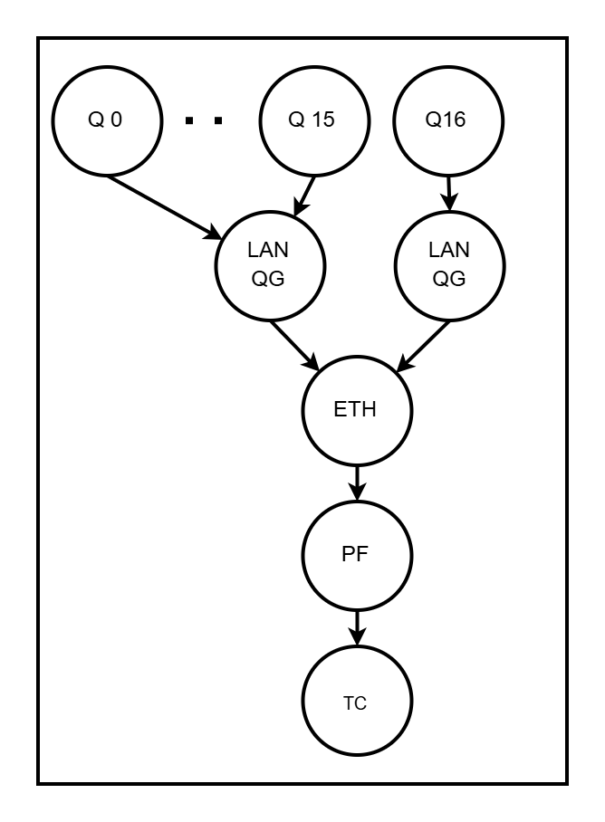</div>

**图 7-2 说明：** Eth 在 Base 选择的 L5 公共 PF root 下创建独立 L6 `eth_root`。每个 L7 QG 最多承载 16 个 L8 Queue；256 个 Queue 满配时需要 16 个 L7 QG。图中的 PF 节点表示实际公共 root，业务只使用逻辑 PF parent，不直接拥有或删除该节点。

#### 7.5.5 FNAV 与 ethtool（PF-02、PF-03）

FNAV 和 ethtool 使用相同形态、不同生命周期的单队列树：

1. 以 PF 节点为整体业务节点的父节点。
2. FNAV 业务只需要一个队列。
3. ethtool 业务只需要一个队列。且 ethtool 业务在测试前创建，测试结束后立即清理。

<div align="center">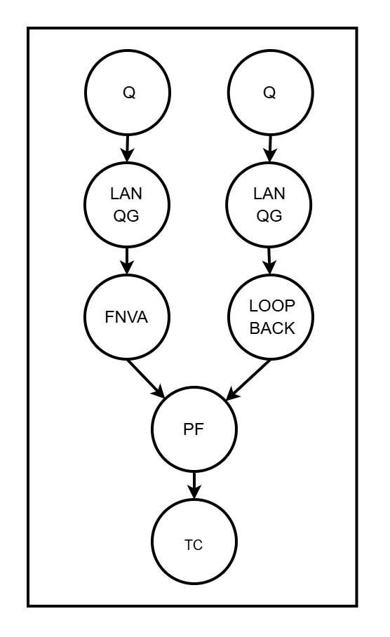</div>

**图 7-3 说明：** FNAV 和 ethtool 业务只有一个队列，L8 直接绑定队列，中间节点没有物理意义。

#### 7.5.6 mqprio（PF-12）

mqprio 设计：

1. 以 PF 节点为整体业务节点的父节点。
2. 最多 16 个 Channel，一个 L6 root 可以直接容纳全部 Channel。
3. 每个 Channel 最多挂 16 个 Queue，总 Queue 数不超过 256。
4. Channel 的 Queue 范围、优先级、权重和限速来自 mqprio 业务的逻辑配置。
5. priority、weight 和速率参数全部配置成功后，mqprio 业务才能发布新的配置。
6. Channel 数、Queue 分配或映射变化时，mqprio 业务使用旧 TEID 发起删除，再按新配置重建并取得新 TEID。

<div align="center">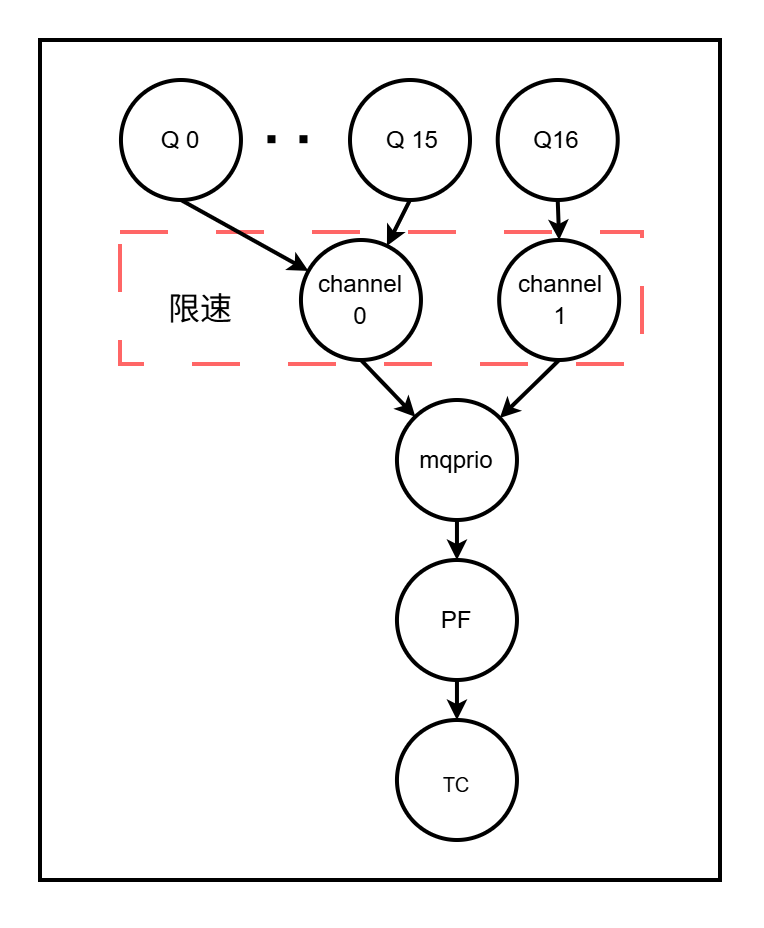</div>

**图 7-4 说明：** mqprio 在公共 PF root 下拥有独立 L6 root，L7 的每个节点表示一个 Channel，channel 具有物理意义可以配置限速，L8 是分配给该 Channel 的 Queue。QoS 参数配置在对应 Channel 的目标节点上。

#### 7.5.7 PF RDMA（PF-04）

业务分析：
1. 以 PF 节点为整体业务节点的父节点。
2. PF RDMA 业务最少使用 1 个控制 QSet，最多使用 1 个控制 QSet + 8 个数据 QSet。
3. 不需要其他层级的物理意义。
4. RDMA 涉及 `move` 操作，即将两个 PF 下的队列绑定到一个 PF 中。

<div align="center">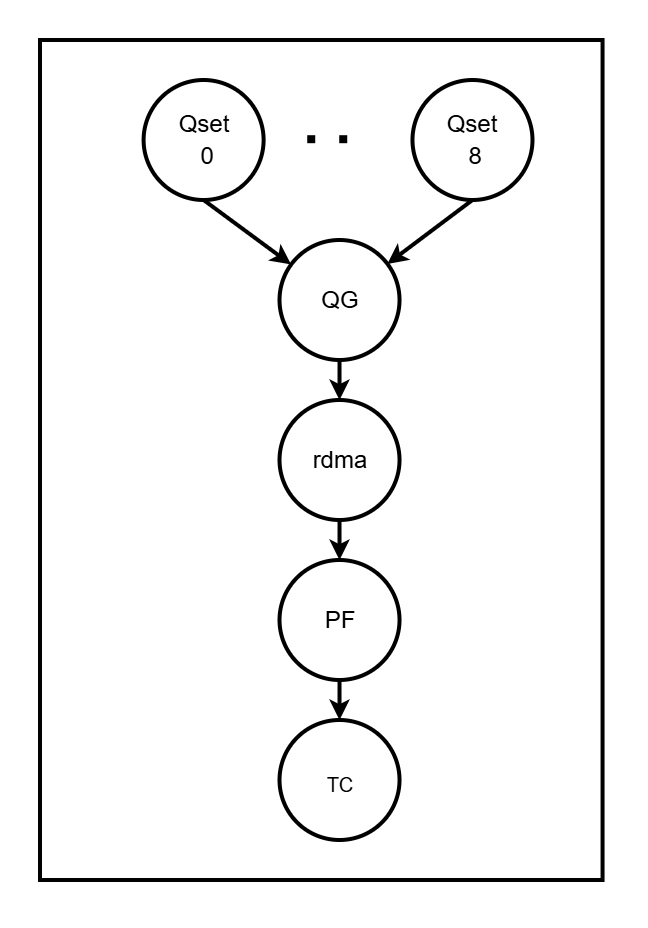</div>

**图 7-5 说明：** PF RDMA 在公共 PF root 下拥有独立 L6 root，L7 无物理意义。L8 层分配给 QSet。

#### 7.5.8 MACVLAN 与 eSwitch（PF-07、PF-08）

MACVLAN 和 eSwitch 为互斥功能。

MACVLAN 设计：

1. 以逻辑 TC 节点为整体业务节点的父节点。
2. 每 PF 最多 64 个设备，每设备一个 Queue。由于设备和队列是一一对应关系，L8 节点完全可以即代表队列也可以代表设备。所以 L8 64 个。
3. L5 层为业务树的根节点，只有 1 个
4. L6、L7 层为中间节点，且无物理意义。根据 64 个设备推算，L7 层 4 个，L6 层 1 个。

<div align="center">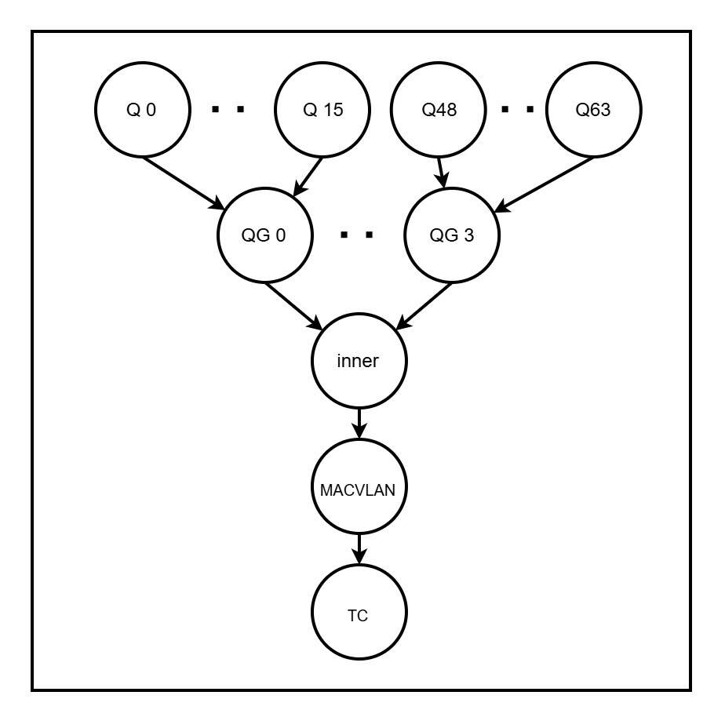</div>

**图 7-6 说明：** MACVLAN 使用一个 L5 节点作为业务 root，L6、L7 层为中间节点，叶子节点最多 64 个。

eSwitch 设计：

1. 以逻辑 TC 节点为整体业务节点的父节点。
2. eSwitch 的 representor Queue 与 VF 的数量一致。最多 1008 个，所以 L8 节点最多 1008 个。
3. L5 层为业务树的根节点，只有 1 个。
4. L6~L7 为中间节点，L7 需要 1008/16=63 个，L6 需要 63 /16 向上取整，为 4 个。

<div align="center">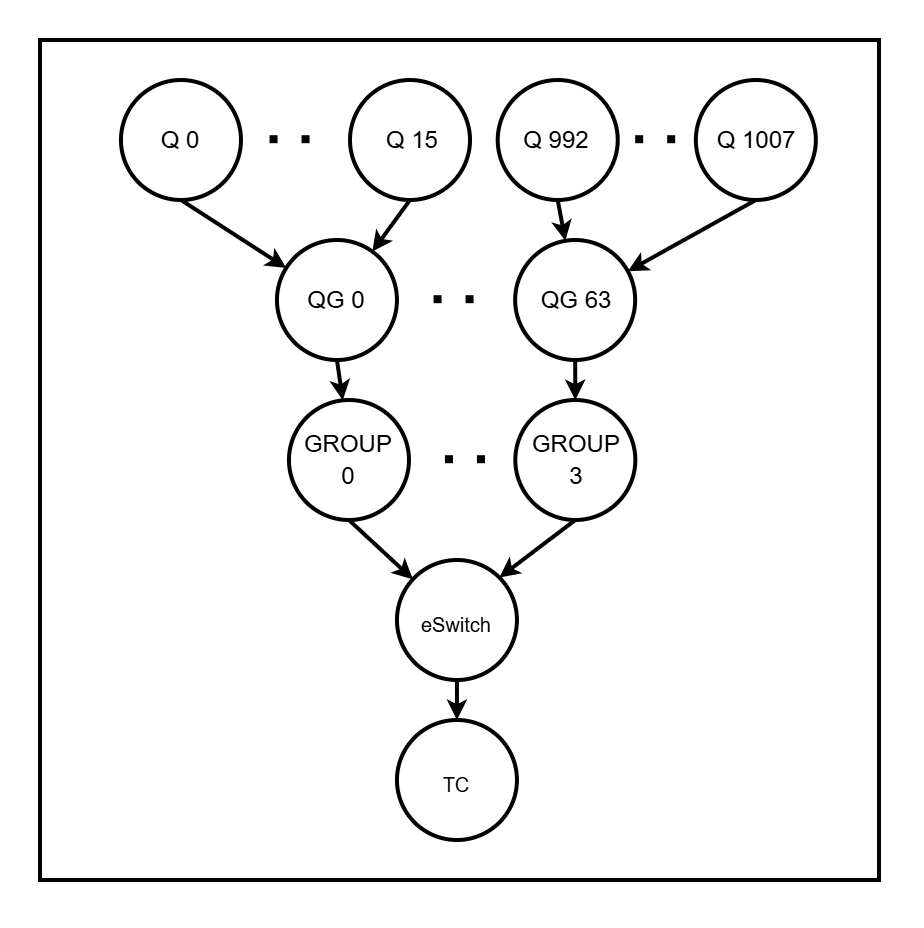</div>

**图 7-7 说明：** eSwitch 使用一个 L5 root、最多 4 个 L6 和 63 个 L7 QG 承载 1008 个 representor Queue。每个 QG 最多 16 个 Queue，每个 L6 Group 最多 16 个 QG，因此四组可以按 16、16、16、15 个 QG 展开。

#### 7.5.9 PF DPDK（PF-05）

PF DPDK 使用 7.5.2 的 TC root 模型，固定拓扑，与 DPDK TM 动态拓扑（见 7.6.1）互斥。

DPDK 设计：

1. 以逻辑 TC 节点为整体业务节点的父节点。
2. PF DPDK 与 PF Eth 所需要的资源数相同，最多有 256 个队列。
3. L5 层为业务树的根节点，只有 1 个，父节点为目标 TC root。
4. L6 层 1 个中间节点；L7 层按每 16 个 Queue 一个 QG 推算，满配 16 个。
5. L8 层为 Queue Leaf，最多 256 个，使用直接 Leaf 路径。
6. 满配资源为 1 个 L5、1 个 L6、16 个 L7 和 256 个 L8。

<div align="center">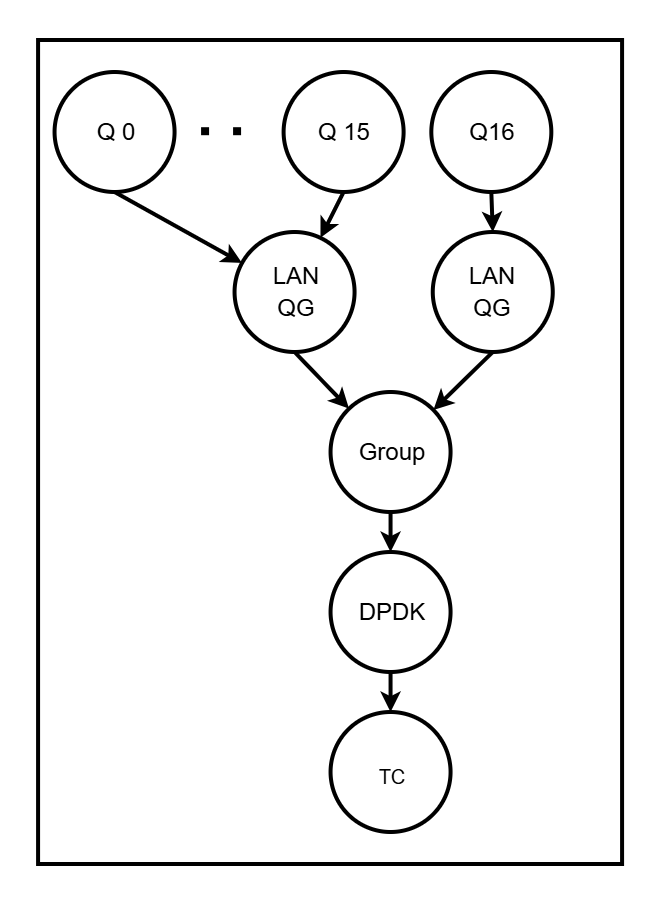</div>

**图 7-8 说明：** DPDK 使用一个 L5 层节点作为 root。L6、L7 节点作为中间节点，L8 绑定队列。

#### 7.5.10 VF Eth、 VF RDMA、VF DPDK

VF Eth 设计：
1. 以 VF 节点为整体业务节点的父节点。
2. VF Eth 最多拥有 64 个 Queue。即 L8 有 64 个。
3. L7 最多有用 64 / 16 = 4 个中间节点(QG)。


VF DPDK 设计：
1. 以 VF 节点为整体业务节点的父节点。
2. VF DPDK 最多拥有 64 个 Queue。即 L8 有 64 个.
3. L7 最多有用 64 / 16 = 4 个中间节点(QG)。
4. DPDK 框架需求需要一个 root。将 VF 的节点作为 DPDK 的 root。


VF RDMA 设计：
1. 以 VF 节点为整体业务节点的父节点。
2. VF RDMA 未开启 Bond 时使用 1 个 QSet，开启 Bond 后最多使用 8 个 QSet。
3. L7 最多 1 个中间节点（QG），8 个 QSet 均可挂在同一个 QG 下。

<div align="center">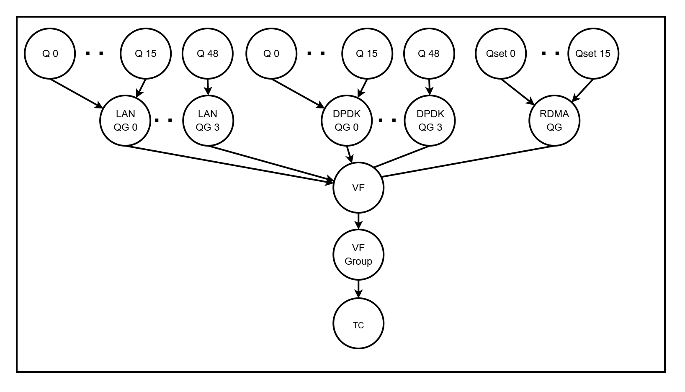</div>

**图 7-9 说明：** 在 VF 节点下，DPDK、RDMA 和 Eth L7 为中间节点，L8 绑定队列。DPDK 和 ETH 的 L7 层含最多 4 个 QG 节点。RDMA 的 L7 层最多 1 个 QG 节点。

#### 7.5.11 VDPA 与 DPDK VDPA（VF-03、VF-04）

VDPA 和 DPDK VDPA 与 VF Eth 功能互斥且资源相同，使用同样的拓扑结构描述。

### 7.6 动态拓扑

动态拓扑确定层级数以及业务根节点，树形拓扑允许在运行期间进行改变。

因此动态拓扑的中间节点（QG、Group）均承载业务含义，需要由业务在满足硬件的前提下指定分组方式。业务运行期间对树拓扑的所有节点感知。

#### 7.6.1 DPDK TM（PF-06、VF-07）

DPDK TM 是 DPDK 的特殊模式，区别与普通模式，需要 DPDK 自己维护业务树的拓扑。每个 DPDK TM 实例必须先分配 root：

DPDK TM 在受控 root 下管理动态 inner/Leaf，处理为：

1. DPDK TM 业务创建或找到自身已经登记的 root。PF 下的 root 为 独立的 L5 节点。VF 下的 root, 由于层次限制，以 VF 节点作为 root，调用 DPDK 根节点进行创建时，直接返回当前 VF 节点的 TEID。
2. 按用户配置创建连续、合法且不超过 L8 的 inner/Leaf 拓扑。
3. 使用两阶段 Leaf 预建节点，再通过 `bind/enable` 关联 Queue。
4. 可以配置根节点下的任意节点的优先级、权重和速率。

拓扑结构同普通模式，不再展示拓扑图。

#### 7.6.2 HTB（PF-11）

HTB 特性：

```
  setup_tc:
  ├─ TC_HTB_CREATE: 创建 HTB 根节点
  ├─ TC_HTB_LEAF_ALLOC_QUEUE: 分配叶子队列
  ├─ TC_HTB_LEAF_TO_INNER: 叶子转内部节点
  ├─ TC_HTB_LEAF_DEL: 删除叶子节点
  ├─ TC_HTB_NODE_MODIFY: 修改节点带宽
  └─ TC_HTB_DESTROY: 销毁 HTB 树  

```

HTB 设计：

1. 以逻辑 TC 节点为整体业务节点的父节点。
2. 每 PF 最多 256 个 L8 Leaf，class 深度不得超过 L5～L8 可表达范围。
3. class ID 和 parent class 关系由 HTB 业务保存，Base 只管理 Node。
4. 新建 class 时先验证目标深度和 parent child 空间，再创建需要的节点。
5. Leaf 转 inner 不是原地改变硬件节点类型：停止受影响流量，删除旧 Leaf 和必要的补齐节点，再按新结构创建分支。
6. `rate`、`ceil` 等可映射到已确认的 CIR/PIR/EIR 参数；动态更新失败时保持原确认配置。
7. 销毁从最深 class/Leaf 开始，存在 child 的 class 不能直接删除。


<div align="center">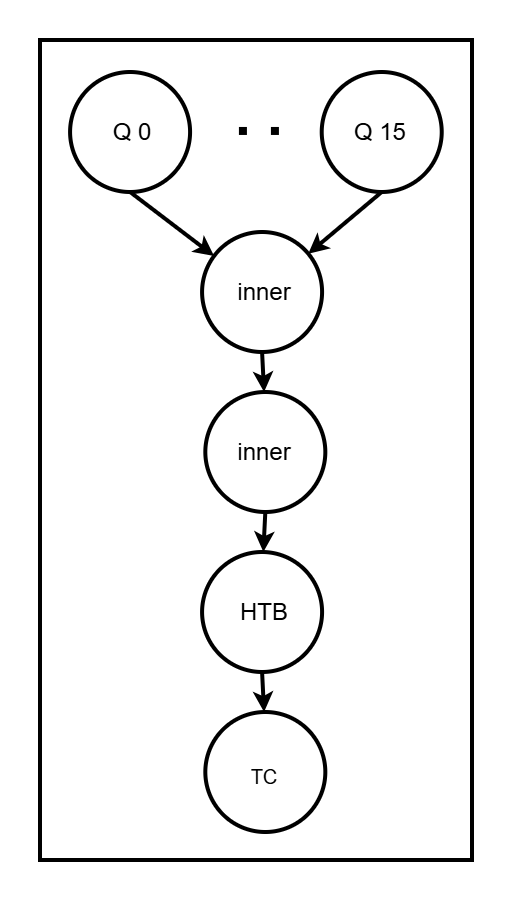</div>

**图 7-10 说明：** HTB 在目标 TC 下拥有独立 L5 root，L6/L7 用于受限深度的 inner class，L8 是 Queue。一个 class 的实际硬件层级由其深度决定，但整条路径必须连续，且不能把带 child 的 inner class 放在 L8。

#### 7.6.3 devlink（PF-13）

本节预留。

当前只确认 PF-13 为 devlink 需求，具体设计待后续专题设计确定。

### 7.7 跨拓扑调整

#### 7.7.1 DCB 队列重分配（PF-09）

DCB 启用多个 TC 后，同一个 PF 或 VF 的 Queue/QSet 会按业务规则分配到不同 TC 下。物理 PF/VF 数量不变，但会在多个 TC 资源空间中形成对应的逻辑调度实例。

1. PF 独立的资源随 TC 使能重建创建，如 FNAV 队列，每 PF 一个。PF RDMA QSet 控制流，每 PF 一个。
2. 非 PF 独立资源平均分配。如 PF Eth 队列按照使能 TC 数平均分配。

<div align="center">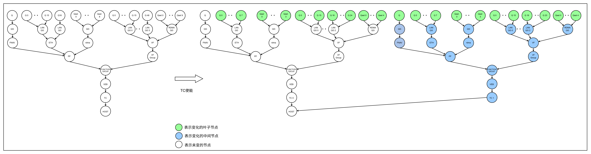</div>

**图 7-11 说明：** 左侧表示单 TC 下 PF、VF、LAN Queue 和 RDMA QSet 的关系；右侧表示新增 TC 后，需要在新 TC 下创建对应 PF/VF、VSI 和 Queue 分支。

#### 7.7.2 VF RDMA 与 DCB（VF-06）

VF RDMA 与 DCB 属于 VF-05 的同一 QSet 管理需求，不再定义独立需求。PF 侧 SR-IOV 业务先为目标 TC 建立 VF_Group/VF root，RDMA 业务再通过 QSet add 在已授权 L6 VF 下挂接 QSet，通过 QSet del 清理旧分支，通过 QSet `move` 调整到新的合法 parent。

#### 7.7.3 Bond 与 QSet Move（PF-10）

Bond 迁移由 RDMA 业务和 Core 编排，Base 执行 QSet `move` 并维护移动后的节点记录。

Move 流程如下：

1. 删除源 RDMA 业务树的 QSet。
2. 在目的 RDMA 业务树创建新的 QSet。

核心原则：本质没有移动叶子节点，而是删除重新创建。

### 7.8 QoS 配置

#### 7.8.1 节点属性公共

业务根据需求发起 QoS 配置的业务直接提交 TEID 和目标优先级、权重、速率配置。Base 根据 TEID 定位 Node 和业务树实例，并校验 Node 归属、层级和参数范围；只有 Firmware 成功后才更新确认状态。

QoS 配置必须遵守：

- CIR 流量优先于 EIR/SRL。
- CIR 同优先级组内使用 RR；EIR/SRL 同优先级组内使用 DWRR。
- 权重只在相同 parent、相同优先级兄弟节点间归一。
- 节点同时配置 EIR 和 SRL 时，按已确认硬件含义只让 SRL 生效。
- 父子带宽约束和业务级策略由业务校验，Base 不自动调整其他节点。

#### 7.8.2 VF 与单 Queue 限速（RL-01、RL-04）

**表7-3 VF 与单 Queue 限速**

| 对象 | 目标节点 | 配置 | 影响范围 |
|---|---|---|---|
| VF | L6 VF | CIR 与 PIR | 该 VF 下全部 Eth、DPDK、VDPA 和 RDMA 分支 |
| Eth PF 单 Queue | L8 Queue Leaf | PIR | 仅目标 Queue |

PF 侧 SR-IOV 业务保存 VF 期望限速，PFR 后在新的 L6 VF Node 创建成功并取得 TEID 后重新配置。在业务树创建成功后，业务树实例保存了 qid 与 TEID 的映射关系，将映射关系保存到对应的 Queue 队列信息中，这样单 Queue 限速可以先使用 Queue 队列信息取得 TEID，再直接使用 TEID 配置。

#### 7.8.3 TM 与 CoS 配置（RL-02、RL-03）

DPDK TM 业务使用 TEID 对自身业务树中的 Node 配置优先级、权重和速率。用户参数必须先转换到硬件允许范围，Base 再根据 TEID 定位 Node 和业务树实例，并确认目标 Node 归入该 DPDK TM 业务树。

#### 7.8.4 VF 通过 SRL 进行限速（RL-05）

SRL 用于让同一层级多个调度节点共享总带宽池，满足对 **不同父节点下的多个 VF** 限速的需求：

1. 根据层次获取或创建 SRL Profile。
2. 将目标 L6 VF 节点关联到该 SRL 配置项，并记录 Firmware 已确认的关联关系。
3. SRL 带宽变化时先更新 Firmware，成功后再更新业务配置。
4. VF 移出分组时先解除节点关联；最后一个成员删除后释放该 SRL 配置项。

Firmware 提供 SRL 配置项总数上限 1024 个。Base 需要保存已经创建的 SRL Profile 数量。创建新配置项时，Base 层先判断是否超过限制，再由 Firmware 最终判断整机是否仍有可用项；资源不足时返回明确错误。

---

## 8. 定位与一致性

### 8.1 定位链路

TX_SCHED 提供两条定位链路：

    首次按队列定位：Queue/QSet 队列信息
      -> 业务树实例
      -> TEID

    后续按节点定位：TEID
      -> Base Context 中的 Node

各段责任如下：

**表8-1 定位链路责任**

| 定位内容 | 责任方 | 处理 |
|---|---|---|
| Queue/QSet 队列信息 | 对应业务 | 在创建 Leaf 时提交；需要按队列查找节点时作为查询条件 |
| 业务树实例 | Base | 维护 Queue/QSet 队列信息、Node 和 TEID 的对应关系，对业务透明 |
| TEID | 对应业务 | 直接使用 Firmware 返回值，不生成 Driver 自定义节点编号 |
| 软件拓扑 | Base | 根据 TEID 定位 Node，并检查调度树归属、parent/child 和层级 |

业务尚不知道 Leaf TEID 时，使用 Queue/QSet 队列信息向 Base 查询；取得 TEID 后，后续操作直接提交该 TEID。Base 在当前 Context 中根据 TEID 定位 Node；需要检查完整路径时，沿 Node 已记录的 parent 关系验证到父节点。

### 8.2 TEID 使用规则

Firmware 创建节点成功后返回 TEID，Driver 直接复用该 TEID 定位和操作节点。这里的“复用”表示 Driver 保存并传递 Firmware 原值，不再分配第二套软件节点 ID，也不建立 `Driver 节点 ID -> TEID` 的额外转换。

Queue/QSet 队列信息与 TEID 的用途不同：

**表8-2 队列信息与 TEID 用途**

| 信息 | 用途 |
|---|---|
| Queue/QSet 队列信息 | 在业务树实例中查找 Leaf，并取得对应 TEID；它是映射查询条件 |
| TEID | 业务取得后直接用于节点查询、属性更新、删除、`bind/enable` 和 `move` |

TEID 在当前 Base Context 中定位 Node。PFR、Reset、Remove 或节点 `DEL` 会清除原 Node 和映射；Firmware 后续可以再次返回相同数值，Driver 仍直接使用 Firmware 本次返回的 TEID，但必须先完成新 Node 登记和 Queue/QSet 映射，不能沿用清理前的对应关系。

### 8.3 生命周期一致性

1. Base 在建树开始时建立业务树实例；只有 Firmware 确认 Node 创建成功后，才把 Node 及其 TEID 记入实例。
2. 只有完整 Template 成功后，Base 才建立 Queue/QSet 到 TEID 的业务映射并返回 TEID；部分 `ADD` 成功项由Base层保存，并记入业务树实例
3. 部分 `DEL` 成功时立即撤销成功节点的 Queue/QSet 到 TEID 映射；失败 Node、TEID 和业务树实例记录保持有效。
4. 配置更新失败时保留旧确认值，不提前提交业务逻辑状态。
5. PFR/Reset/Remove 前停止使用旧 TEID 并撤销旧映射；PFR reinit 后由 Eth、RDMA、DPDK 等业务分别重新发起创建，Base 使用 Firmware 本次返回的 TEID 建立新 Node 和映射。Reset 和 Remove 流程不重建业务调度树。
6. Firmware 可以复用 TEID 数值。Base 只认可当前 Context 中已经登记的 Node；相同数值只有在 Firmware 为新 Node 返回且 Base 完成登记后，才能再次使用。
7. DPDK 用户态使用当前 Context 中未登记的 TEID 时返回无效节点错误。

### 8.4 定位输出

问题定位信息至少能够回答：

- 哪个 PF、TC、业务和业务实例发起了操作。
- Queue/QSet 队列信息映射到哪个 TEID，以及该 TEID 对应哪个业务树实例和 Node。
- 节点位于哪一层、parent 是谁、直接 child 数是多少。
- Leaf 映射的 Queue/QSet 队列信息和类型是什么。
- Firmware 哪一条命令、哪一个批量项失败。
- 操作后当前 Context 各层已确认节点数如何变化。

Base 定位输出必须直接遍历 Context 管理的 Node 记录，按已保存的 parent/child 关系打印当前确认拓扑；不能从 Tree Template 或业务期望配置反向拼接。公共 PF Root、正常业务 Node 和部分 `ADD` 内部清理 Node 都属于输出范围。对应业务的快照补充 Queue/QSet 队列信息和直接复用的 TEID。

---

## 9. 可测试性与验收

### 9.1 单元测试

Base 使用 AdminQ 模拟实现验证通用规则；Eth、RDMA、DPDK、HTB 等业务使用 Base 模拟实现或测试实例验证各自拓扑设计和生命周期。故障注入必须覆盖命令失败、逐项失败、部分成功、超时和非法响应。

**表9-1 单元测试**

| 编号 | 测试 | 主要验收点 |
|---|---|---|
| UT-01 | 层级与 parent | 跳层、L8 parent、跨 PF、无效 TC 和未授权 node 在命令前失败 |
| UT-02 | 16 child | 同一 node parent 跨多棵 tree 的前 16 个 child 可创建，第 17 个失败 |
| UT-03 | 各层物理节点数量检查 | 本次各层新增节点数与当前 Context 对应层已确认节点数之和超过该硬件层物理节点总数时快速失败；跨 Context（跨 PF 或跨 TC）冲突由 Firmware 错误表达 |
| UT-04 | 公共 PF root | 全 PF 固定单个公共 PF root，由 Base 在 probe 创建、remove 销毁；业务不能删除或修改该节点；PF root 下第 17 个直接 child 创建失败 |
| UT-05 | 实例和节点归属 | 业务通过业务树实例获取 TEID；Base 拒绝用其他业务树的 TEID 修改 Node，child tree 不删除父节点 |
| UT-06 | 直接 Leaf | Queue/QSet 队列信息能够取得 Firmware 原始 TEID，重复映射、错误类型、`ADD`/`DEL` 和各层已确认节点数更新正确 |
| UT-07 | 两阶段 Leaf | 通用 Leaf `ADD`、`bind/enable` 和直接 `QUEUE/QSET DEL` 顺序正确，删除不发送解绑或停用命令 |
| UT-08 | 部分 `ADD` | 返回错误且不建立 Queue/QSet 到 TEID 的业务映射；成功节点计入当前 Context 对应层已确认节点数，通过业务树实例返回给业务接口层 |
| UT-09 | 部分 `DEL` | 成功节点移除，失败节点和业务树实例保留，不删除失败节点 parent |
| UT-10 | 超时与非法响应 | 不自动重试、不猜测未确认节点、日志包含原始和转换错误 |
| UT-11 | TEID 与属性更新 | Driver 返回和使用的 TEID 与 Firmware 原值一致；相同属性值不重复下发，成功后更新，失败后保留原确认值 |
| UT-12 | PFR | Firmware 清空后 Base 不发送 `DEL`到固件，删除 Node 和映射；业务接口层删除旧业务树实例；reinit 后各业务接口层重新创建业务树实例并直接使用 Base 层新返回的 TEID |
| UT-13 | Reset | 内存清理与 PFR 同理；各业务不重建 |
| UT-14 | 日志与快照 | 从 Node 记录打印公共 Root、正常/内部清理节点、parent/child、Queue/QSet 队列信息、TEID 和各层已确认节点数 |

### 9.2 业务边界测试

**表9-2 业务边界测试**

| 业务 | 边界 |
|---|---|
| Eth PF | Queue 数量 1、16、17、256 成功；0、257 失败 |
| VF Group | 第 16 个 VF 复用当前 Group，第 17 个创建新 Group |
| VF Queue | 64 个 Queue 对应 4 个 QG；超过业务上限失败 |
| eSwitch | 1008 Queue 对应 4 个 L6 Group、63 个 L7 QG，所有 parent 不超过 16 child |
| MACVLAN | 64 个设备对应 1 个 L6、4 个 L7 QG 和 64 个 L8 Leaf |
| mqprio | 16 个 Channel 满配；单 Channel 或总 Queue 超限失败 |
| PF RDMA | 8+1 QSet 能在一个 L7 Group 下表达，每个 QSet 的队列信息唯一 |
| HTB | 256 Leaf、最大合法深度、Leaf 转 inner 和非空 class 删除 |
| SRL | 1024 个配置项上限、节点加入/退出、最后成员释放、PFR 后重建和 Reset 不重建 |

### 9.3 回归测试

**表9-3 回归测试**

| 编号 | 覆盖需求 | 验收 |
|---|---|---|
| RT-01 | PF-01～PF-04 | Eth、FNAV、ethtool 和 PF RDMA 独立创建销毁，互不删除节点 |
| RT-02 | PF-05、PF-06 | DPDK 普通/TM 模式均先取得受控 root，固定/动态拓扑、用户映射和 QoS 生效 |
| RT-03 | PF-07、PF-08 | MACVLAN 64 设备和 eSwitch 1008 representor 满配数据通路正常 |
| RT-04 | PF-09、PF-12 | DCB 8 TC 重建和 mqprio 16 Channel 的队列、优先级及限速正确 |
| RT-05 | PF-10、PF-11 | Bond QSet 迁移与 HTB 动态 class 生命周期正确 |
| RT-06 | VF-01、VF-02、VF-05、VF-07 | VF_Group、VF 配置树、VF RDMA QSet `add`/`del`/`move`、多 TC 和 VF TM 边界正确 |
| RT-07 | RL-01～RL-05 | VF、Queue、DPDK TM、CoS 和 SRL 的带宽及仲裁结果符合配置 |
| RT-08 | 公共生命周期 | `open/close`、配置变化、业务树实例对业务透明、Queue/QSet 到 TEID 映射、PFR 后业务重建和 Reset/Remove 不重建均正确 |
| RT-09 | 多业务并发 | 多业务竞争 L5 时处理稳定，已运行的无依赖 tree 不被破坏 |